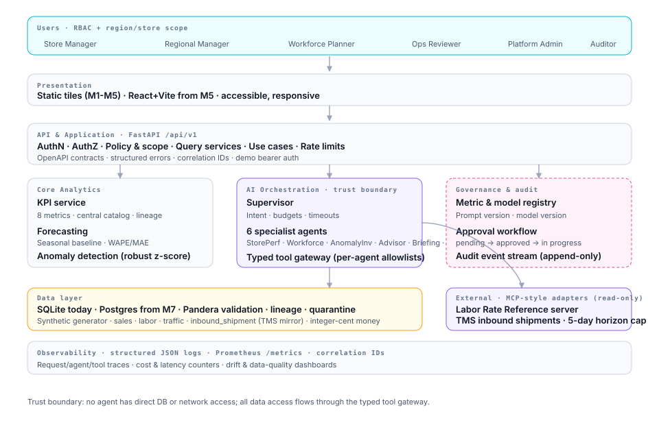
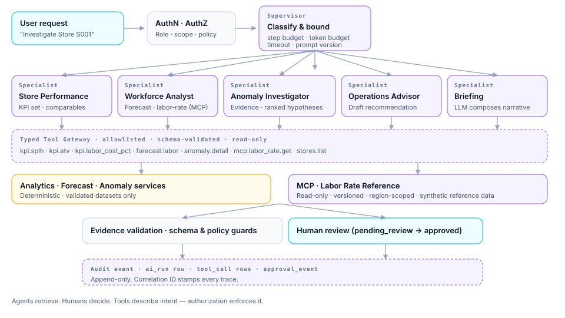
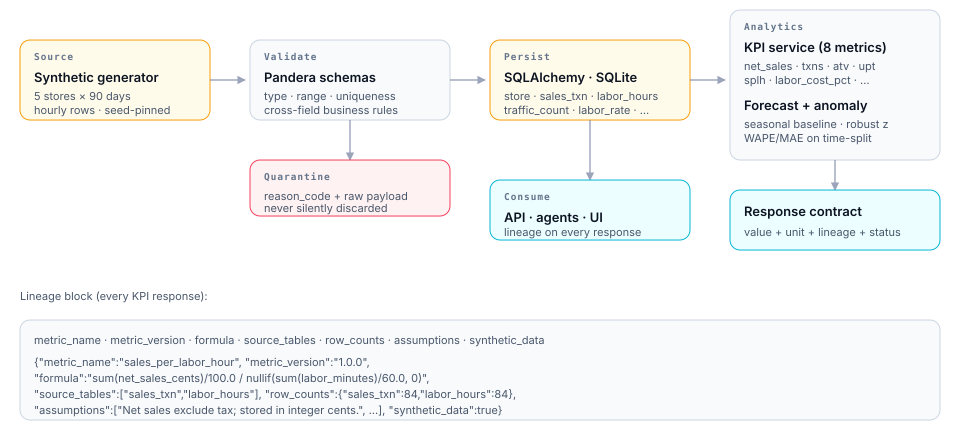
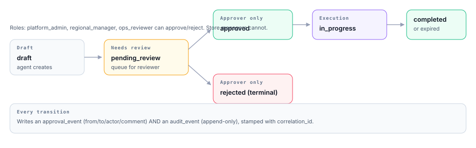

# StorePulse-AI

> **AI-Powered Store Operations · Workforce Intelligence · Decision Platform**
> Governed, evidence-first decision intelligence for multi-store retailers.

<p>
<a href="#test-results">63 tests · all passing</a> ·
<a href="#5-security-posture-owasp-aligned">OWASP-mapped controls</a> ·
<a href="#4-agentic-architecture">5 specialist agents + supervisor</a> ·
<a href="#6-observability-logging--monitoring">JSON logs · Prometheus metrics</a> ·
<a href="#7-human-in-the-loop-approval-workflow">Human-approved recommendations</a>
</p>

---

## Table of contents

1. [Purpose](#1-purpose)
2. [Problem statement](#2-problem-statement)
3. [Proposed solution](#3-proposed-solution)
4. [Architecture](#4-architecture)
   - [System diagram](#system-architecture)
   - [Agentic architecture](#agentic-architecture)
   - [Data flow](#data-flow)
5. [Security posture (OWASP-aligned)](#5-security-posture-owasp-aligned)
6. [Observability, logging & monitoring](#6-observability-logging--monitoring)
7. [Human-in-the-loop approval workflow](#7-human-in-the-loop-approval-workflow)
8. [Automation & orchestration](#8-automation--orchestration)
9. [API reference](#9-api-reference)
10. [Local setup — run everything in 5 minutes](#10-local-setup)
11. [Testing & quality](#11-testing--quality)
12. [Repository layout](#12-repository-layout)
13. [Technology choices](#13-technology-choices)
14. [Honest status & known gaps](#14-honest-status--known-gaps)
15. [Roadmap](#15-roadmap)

---

## 1. Purpose

**StorePulse-AI is a governed *decision-support* platform — not an autonomous scheduler or employee-management authority.**

It unifies fragmented store, workforce, and operations data into a trusted analytics core and layers constrained agentic workflows on top. Every recommendation carries its evidence, its assumptions, and a human reviewer. Deterministic code handles math; large language models only summarise verified evidence.

> **Product promise.** Move store teams from *"what happened?"* to *"what's likely next, why, and what should we consider doing"* — with every claim traceable to its data, its time window, and the reviewer who approved it.

---

## 2. Problem statement

Multi-store retailers run on data that never meets in one place. A regional manager overseeing 40 stores typically touches **6+ systems before 9am** — POS, workforce management, inventory, labor-budget sheets, exception emails, BI dashboards — then reconciles the gaps in a spreadsheet. The data exists. **The decision window does not.**

| # | Fragmentation | Operational cost |
|---|---|---|
| 1 | Sales, labor, footfall, inventory in separate systems | Managers reconcile in spreadsheets — no trusted unified picture by 9am |
| 2 | Dashboards are descriptive, not diagnostic | The same "why" questions are re-asked every week |
| 3 | Static staffing plans built on weekly averages | Peak periods lose conversion; trough periods carry excess hours |
| 4 | Anomalies surface at month-end | By the time a manager hears about it, the week, promo, or season is over |
| 5 | **Three teams, three versions of "sales per labor hour"** | Decision cycles stall on definitional debates |
| 6 | DC truck ETA not joined to shift plan | Labor arrives, inventory doesn't; paid idle hours leak out as a silent tax |
| 7 | Forecasts ignore weather, events, local news | Lost sales on surge days, paid idle labor on collapse days |
| 8 | Customer sentiment measured by occasional NPS | Frustrated shoppers go unnoticed until review/return/churn |

StorePulse-AI's v1.0 attacks items **1–5** head-on with a trusted metric layer, constrained agents, and a review queue. Items 6–8 are explicit future scope.

---

## 3. Proposed solution

A **modular monolith** with clean architecture and a strict trust boundary around the AI runtime. Nine capabilities land in sequence:

| Capability | Status in v1.0 |
|---|---|
| Regional command center (8 KPIs with lineage) | ✅ shipped |
| Workforce demand forecast (seasonal baseline + WAPE/MAE) | ✅ shipped |
| Anomaly & exception feed (robust z-score + thresholds, evidence) | ✅ shipped |
| Evidence-first agentic investigation (5 specialists + supervisor) | ✅ shipped |
| Daily store manager briefing | ✅ shipped |
| Human review & approval workflow | ✅ shipped |
| Audit trail, metric catalog, model versioning | ✅ shipped |
| MCP labor-rate reference server (in-process adapter) | ✅ shipped |
| DC & truck tracking · external signals (weather/events) · camera sentiment | ⏳ future |

Design pillars ("principles that shape every build decision"):

1. **Deterministic where it counts.** SQL, KPI math, validation, forecasts are code — never LLM calls.
2. **Evidence or silence.** Every finding cites the metric, window, and source. Insufficient data returns `null`, never a fabricated number.
3. **Read-only by default.** No schedule, employee, or payroll mutation. Recommendations route to a human reviewer.
4. **Least-privilege tools.** Agents reach the world only through a typed, allowlisted gateway. Tool descriptions aren't security — authorization is.
5. **Responsible workforce AI.** No individual employee scoring, ranking, or surveillance. Forecasts estimate workload, not punish people.
6. **Honest status.** Synthetic data is labeled synthetic. Opportunity estimates are labeled estimates. Compliance claims require independent assessment.

---

## 4. Architecture

### System architecture



Four logical layers in a single deployable:

- **Presentation** — static HTML tiles today (React+Vite from M5). Three live screens: Regional, Investigation, Approvals.
- **API & Application** — FastAPI `/api/v1`, Pydantic contracts, demo bearer auth, RBAC + region/store scope on every endpoint, correlation IDs, structured errors.
- **Core pillars**
  - *Analytics* — 8 KPIs with central metric catalog + lineage. Forecasting (seasonal baseline). Anomaly detection (robust z-score + thresholds).
  - *AI orchestration* — supervisor + 5 specialists. Typed tool gateway with per-agent allowlists. Deterministic LLM provider (production provider pluggable).
  - *Governance* — audit event stream, approval workflow, metric/prompt/model versioning.
- **Data layer** — SQLAlchemy on SQLite (ANSI-SQL; Postgres swap in M7). Pandera validation at ingest, quarantine with reason codes.
- **External · MCP adapter** — read-only Labor Rate Reference server exposing `get_labor_rate`, `list_labor_rate_regions`, `get_labor_rate_metadata`.
- **Observability** — structured JSON logs, correlation IDs, Prometheus-text `/metrics` with counters and summaries.

### Agentic architecture



**Supervisor-orchestrated workflow with narrowly scoped specialists.** Agents retrieve. Humans decide.

1. **Request** → authenticated, scope-checked, correlation-stamped.
2. **Supervisor** → classifies intent (`store_investigation`, `anomaly_investigation`, `daily_briefing`), applies step/token/time budgets.
3. **Specialists** — each has its own allowlist:

   | Agent | Role | Allowlisted tools |
   |---|---|---|
   | `store_performance` | Retrieves store KPIs vs comparable period | `kpi.*`, `stores.list` |
   | `workforce` | Reads labor forecast + MCP labor-rate; explains cost assumptions | `forecast.labor`, `kpi.labor_cost_pct`, `mcp.labor_rate.get` |
   | `anomaly_investigator` | Pulls anomaly detail, ranks evidence-cited hypotheses (correlation, not causation) | `anomaly.*`, `kpi.*`, `forecast.labor` |
   | `operations_advisor` | Composes a pending-review recommendation; policy guard blocks forbidden language | synthesises from upstream agents' output |
   | `briefing` | Composes a daily manager briefing; LLM narrates verified evidence only | `kpi.*`, `anomaly.list`, `forecast.labor` |

4. **Typed tool gateway** validates args against Pydantic schemas, enforces the allowlist and the principal↔store scope, times every call, writes a `tool_call` row for every attempt (success, denied, or error).
5. **Evidence check** → every output is schema-validated; recommendations are pattern-checked for forbidden language ("cut hours", "layoff", …) before persistence.
6. **Human review** → recommendations land in the `pending_review` queue. Only `platform_admin`, `regional_manager`, and `ops_reviewer` roles can approve or reject.
7. **Audit** → `ai_run` + `tool_call` + `audit_event` rows persist for every workflow, with model and prompt versions recorded.

**Agentic loop (pseudocode)**

```python
def investigate_store(ctx, store_id, from_utc, to_utc):
    budget = RunBudget(max_steps=20, max_tokens=2000, timeout_s=20.0)
    run_id = new_id(); step = 0; tokens = 0

    sp = store_performance.run(ctx, run_id, store_id, from_utc, to_utc)
    step = sp.last_seq; budget.check(step, tokens, elapsed)

    wf = workforce.run(ctx, run_id, store_id, from_utc, to_utc, region,
                       start_seq=step)
    step = wf.last_seq; budget.check(step, tokens, elapsed)

    advisor = operations_advisor.run(ctx, run_id, sp, wf, start_seq=step)
    # Advisor produces a draft recommendation; policy guard runs inside.

    persist_ai_run(run_id, step, tokens, output={sp, wf, advisor})
    record_audit(actor=ctx.principal.subject, action="ai_run.store_investigation")
    emit_metric("storepulse_agent_runs_total", intent="store_investigation",
                status="ok")
    create_recommendation(advisor.recommendation, status="pending_review")
    return run_id, advisor.recommendation
```

### Data flow



Every KPI response carries a **lineage** block so the number is defensible:

```json
{
  "value": 13.4171,
  "unit": "USD per labor hour",
  "window": { "from_utc": "2026-09-24T00:00:00Z", "to_utc": "2026-10-01T00:00:00Z" },
  "lineage": {
    "metric_name": "sales_per_labor_hour",
    "metric_version": "1.0.0",
    "formula": "sum(net_sales_cents)/100.0 / nullif(sum(labor_minutes)/60.0, 0)",
    "source_tables": ["sales_txn", "labor_hours"],
    "row_counts": { "sales_txn": 84, "labor_hours": 84 },
    "assumptions": [
      "Net sales exclude tax; stored in integer cents.",
      "Window is half-open [from_utc, to_utc); times in UTC."
    ],
    "synthetic_data": true
  },
  "status": "ok"
}
```

---

## 5. Security posture (OWASP-aligned)

Controls implemented today, mapped to OWASP taxonomies (full matrix in [`docs/OWASP_CONTROL_MAPPING.md`](docs/OWASP_CONTROL_MAPPING.md) once scanned — in v1.0 the controls themselves ship; the formal mapping sign-off is M6):

| OWASP item | How it's addressed in v1.0 |
|---|---|
| **API #1 — Broken Object Level Authorization (BOLA)** | Every KPI / forecast / anomaly / recommendation endpoint resolves store → region and calls `ensure_store_access(principal, store_id, region)`. Covered by regression tests `test_west_manager_cannot_see_s002`, `test_s001_manager_cannot_see_s002`. |
| **API #5 — Broken Function Level Authorization (BFLA)** | Approval endpoint requires one of `{platform_admin, regional_manager, ops_reviewer}`. Store managers get 403 on `/recommendations/:id/review` — tested. |
| **API #2 — Broken Authentication** | Bearer token on every request; missing/invalid token → 401. Zero endpoints anonymous beyond `/api/v1/health` and `/metrics`. |
| **API #3 — Broken Object Property Level Authorization** | Pydantic response models whitelist exactly what the client sees; no `model_dump()` of internal fields. Audit payload never contains raw prompts. |
| **Web #1 — Broken Access Control** | RBAC + resource-level scope enforcement centralized in `apps/api/security.py`. |
| **Web #3 — Injection** | 100% parameterized SQL via SQLAlchemy `text(...)` with bound params. No string interpolation into SQL anywhere. |
| **LLM #1 — Prompt Injection** | LLM provider receives only an **evidence dict**, never raw user text. The DeterministicProvider is literally a template that reads evidence keys — `test_injection_in_user_prompt_cannot_change_output` proves a hostile user prompt cannot alter output. |
| **LLM #2 — Sensitive Information Disclosure** | LLM output never contains secrets; prompts are never logged; `evidence_json` columns stay server-side. |
| **LLM #5 — Improper Output Handling** | Every agent output is schema-validated before persistence. The `operations_advisor` additionally runs a forbidden-language guard. |
| **LLM #6 — Excessive Agency** | No tool mutates state. Human approval required for every recommendation. The tool gateway enforces an **allowlist per agent**, not a global one. |
| **Agentic AI — Tool permission escalation** | Per-agent allowlist (see [`packages/tool_gateway/tools.py`](packages/tool_gateway/tools.py)). `test_tool_denied_when_outside_allowlist` proves the briefing agent cannot call `mcp.labor_rate.get`. |
| **Agentic AI — Unbounded loops** | Supervisor enforces `max_steps`, `max_tokens`, `timeout_s`. Exceeding any budget raises and the run is persisted with `status="error"`. |
| **Agentic AI — Audit** | Every workflow writes `ai_run`, `tool_call[]`, `audit_event`, and (when applicable) `approval_event` rows. Append-only tables; no UPDATE/DELETE from app code. |

### Responsible workforce AI

- No scoring, ranking, or surveillance of individual employees.
- Forecasts measure **workload demand**, not people.
- `operations_advisor` pattern-blocks forbidden phrasing: *cut hours · reduce hours · fire · terminate · layoff · lower pay*. Blocked drafts get rewritten to a safe "hold current plan" default.
- Labor rates come from the MCP server as a versioned reference, not a hard-coded constant — and they inform *cost assumptions*, never pay decisions.

### Honest limitations

- Demo bearer auth is for local use only. Real OIDC is a drop-in replacement for `authenticate()`.
- No TLS, CSRF, or CSP today — those land with the deployment configuration in M7.
- No dependency-scan CI yet. `pyproject.toml` pins versions; `pip-audit` integration is M6 scope.

---

## 6. Observability, logging & monitoring

### Structured JSON logging

Every log line is a single-line JSON object with correlation ID:

```json
{"ts":"2026-11-07T04:17:55.194Z","level":"INFO","logger":"storepulse.api",
 "cid":"97b9f0646282","msg":"http_request",
 "method":"GET","path":"/api/v1/kpi/splh","status":200,"duration_ms":6}
```

- Correlation ID is accepted on inbound `x-correlation-id` or generated server-side, then echoed in the response header.
- The `cid` propagates to agent runs, tool calls, audit events, and approval events (via `packages.observability.logging.set_correlation_id`).
- Prompts and raw tool arguments are **not** logged at `INFO`.

### Prometheus-text metrics

`GET /metrics` returns:

```
# HELP storepulse_http_requests_total Count of HTTP requests served.
# TYPE storepulse_http_requests_total counter
storepulse_http_requests_total{method="GET",path="/api/v1/kpi/splh",status="200"} 1.0
storepulse_agent_runs_total{intent="store_investigation",status="ok"} 1.0
storepulse_tool_calls_total{status="denied",tool="mcp.labor_rate.get"} 2.0
storepulse_tool_calls_total{status="ok",tool="kpi.splh"} 7.0
storepulse_kpi_requests_total{metric="splh"} 1.0
storepulse_http_request_ms_count{method="POST",path="/api/v1/agents/investigate-store"} 1.0
storepulse_http_request_ms_sum{method="POST",path="/api/v1/agents/investigate-store"} 106.0
storepulse_http_request_ms{method="POST",path="/api/v1/agents/investigate-store",quantile="0.9"} 106.0
```

### What to monitor

| Dimension | Metric |
|---|---|
| Traffic / latency | `storepulse_http_requests_total`, `storepulse_http_request_ms{quantile}` |
| KPI consumption | `storepulse_kpi_requests_total{metric}` |
| Agent health | `storepulse_agent_runs_total{intent,status}` |
| Governance | `storepulse_tool_calls_total{tool,status}` — spikes in `status="denied"` reveal scope-policy or allowlist attacks |
| Human review | `storepulse_recommendations_total{status}` — queue backlog alerts on `pending_review` growth |
| Data quality | Anomaly table size by severity; quarantine count by `source_dataset` |

Grafana dashboards + OpenTelemetry collector land in M6; the exposition format is already stable so the dashboards themselves are a config change.

---

## 7. Human-in-the-loop approval workflow



**Nothing moves in a source system.** Agents can only produce draft recommendations. Every recommendation walks this state machine:

```
draft -> pending_review -> approved | rejected
approved -> in_progress -> completed | expired
rejected -> (terminal)
```

- Roles that can approve/reject: `platform_admin`, `regional_manager`, `ops_reviewer`.
- Store managers can **view** scoped recommendations but not transition them.
- Every transition writes a row to `approval_event` **and** `audit_event`, both append-only, both stamped with the request's correlation ID.
- Invalid transitions return `409 Conflict`; forbidden roles return `403`; missing recommendations return `404`.

Try it from the UI at `http://localhost:8000/approvals.html`, or via the API:

```bash
curl -X POST -H "Authorization: Bearer demo-reviewer" \
  -H "Content-Type: application/json" \
  -d '{"decision":"approve","comment":"evidence looks reasonable"}' \
  http://localhost:8000/api/v1/recommendations/<rec_id>/review
```

---

## 8. Automation & orchestration

**Three one-command pipelines** make v1.0 reproducible from a clean clone:

```bash
python -m scripts.generate_data --seed 42 --days 90   # deterministic synthetic data
python -m scripts.load_db                             # Pandera-validated ingest + seed catalog
python -m scripts.run_forecast --horizon-days 14      # fit seasonal baseline + evaluate WAPE/MAE
python -m scripts.run_anomalies --days 30             # robust-zscore + coverage-gap detection
```

Then start the service:

```bash
python -m uvicorn apps.api.main:app --port 8000
```

### Agent workflows

Four composable triggers — each creates an `ai_run` with full audit trail:

| Trigger | Endpoint |
|---|---|
| Investigate a store (full KPI + workforce + advisor) | `POST /api/v1/agents/investigate-store` |
| Investigate a specific anomaly (hypothesis ranking) | `POST /api/v1/agents/investigate-anomaly` |
| Generate a daily store briefing | `POST /api/v1/agents/briefing` |
| Approve / reject / start / complete a recommendation | `POST /api/v1/recommendations/:id/review` |

### Budgets

The supervisor enforces three budgets on every run:

```python
RunBudget(max_steps=20, max_tokens=2000, timeout_s=20.0)
```

Blown budgets abort the run cleanly and persist `status="error"` with the reason. Nothing is left half-committed because every tool call is wrapped in its own transaction.

---

## 9. API reference

Full OpenAPI at `http://localhost:8000/docs`. Highlights:

**Ops**

| Method | Path | Purpose |
|---|---|---|
| GET | `/api/v1/health` | Liveness |
| GET | `/metrics` | Prometheus text exposition |

**Master data**

| Method | Path |
|---|---|
| GET | `/api/v1/stores` — scoped to principal |
| GET | `/api/v1/regions` |
| GET | `/api/v1/metric-catalog` |

**KPIs** (all return `{value, unit, window, lineage, status}`)

| GET | `/api/v1/kpi/{splh,net_sales,transactions,atv,upt,visitors,conversion_rate,labor_cost_pct}` |
|---|---|

**Forecast / anomaly**

| Method | Path |
|---|---|
| GET | `/api/v1/stores/{store_id}/workforce/forecast?from=&to=` |
| GET | `/api/v1/anomalies?store_id=&status=&limit=` |
| GET | `/api/v1/anomalies/{anomaly_id}` |

**Agents**

| Method | Path |
|---|---|
| POST | `/api/v1/agents/investigate-store?store_id=&from=&to=` |
| POST | `/api/v1/agents/investigate-anomaly?anomaly_id=` |
| POST | `/api/v1/agents/briefing?store_id=&as_of_utc=` |

**Recommendations**

| Method | Path |
|---|---|
| GET | `/api/v1/recommendations?status=&store_id=` |
| GET | `/api/v1/recommendations/{id}` |
| POST | `/api/v1/recommendations/{id}/review` — body `{decision, comment}` |

**Audit** (platform_admin / ops_reviewer only)

| Method | Path |
|---|---|
| GET | `/api/v1/audit?actor=&target_type=&limit=` |

Demo bearer tokens:

| Token | Role | Scope |
|---|---|---|
| `demo-admin` | `platform_admin` | all regions, all stores |
| `demo-regional-west` | `regional_manager` | region `West` |
| `demo-store-s001` | `store_manager` | store `S001` |
| `demo-reviewer` | `ops_reviewer` | all; can approve/reject |

---

## 10. Local setup

> Requirements: Python 3.11+. No Docker, no Node, no Postgres needed for v1.0.

```bash
# 1. Install pinned dependencies
python -m pip install -e ".[dev]"

# 2. Generate deterministic synthetic data (5 stores × 90 days × hourly)
python -m scripts.generate_data --seed 42 --days 90 --out data/synthetic

# 3. Create schema, validate, load, seed metric_catalog + labor_rate
python -m scripts.load_db --in data/synthetic

# 4. Train the seasonal baseline forecast (14-day horizon)
python -m scripts.run_forecast --horizon-days 14

# 5. Run anomaly detection over the last 30 days
python -m scripts.run_anomalies --days 30

# 6. Run the full test suite (63 tests)
python -m pytest tests/ -v

# 7. Start the API + UI
python -m uvicorn apps.api.main:app --port 8000
```

Open `http://localhost:8000/` for the Regional Command Center tile, `/investigation.html` for agent investigations, `/approvals.html` for the human review queue.

### Live smoke test

```bash
curl -s -H "Authorization: Bearer demo-admin" \
  "http://localhost:8000/api/v1/kpi/splh?store_id=S001&from=2026-09-24T00:00:00Z&to=2026-10-01T00:00:00Z"
# -> {"value":13.4171, ..., "lineage":{..."metric_version":"1.0.0"}, "status":"ok"}

curl -s -X POST -H "Authorization: Bearer demo-admin" \
  "http://localhost:8000/api/v1/agents/investigate-store?store_id=S001&from=2026-09-24T00:00:00Z&to=2026-10-01T00:00:00Z"
# -> {"run_id":"...", "status":"ok", "step_count":13, "output":{...}}
```

---

## 11. Testing & quality

### Test results

```
tests\integration\test_api_agents_e2e.py ..                              [  3%]
tests\integration\test_api_kpis_and_security.py .........                [ 17%]
tests\integration\test_api_splh.py ........                              [ 30%]
tests\security\test_prompt_injection.py ..                               [ 33%]
tests\unit\test_all_kpis.py ..........                                   [ 49%]
tests\unit\test_anomaly_detector.py ..                                   [ 52%]
tests\unit\test_approval_workflow.py ....                                [ 58%]
tests\unit\test_fake_llm.py ..                                           [ 61%]
tests\unit\test_forecast_baseline.py ....                                [ 68%]
tests\unit\test_generator_determinism.py ..                              [ 71%]
tests\unit\test_mcp_labor_rate.py ......                                 [ 80%]
tests\unit\test_pandera_schemas.py ...                                   [ 85%]
tests\unit\test_splh_math.py .....                                       [ 93%]
tests\unit\test_tool_gateway.py ....                                     [100%]

======================= 63 passed, 1 warning in 11.71s ========================
```

### What's covered

| Layer | What's verified |
|---|---|
| **KPI math** | Every metric's formula, edge cases (empty window, zero denominator, half-open semantics), lineage envelope. |
| **Pandera validation** | Negative sales, bad store IDs, wrong currency — all quarantined with reason codes. |
| **Generator** | Byte-identical output under the same seed; different seeds diverge. |
| **Forecasting** | DOW-hour prediction level, 80% intervals, WAPE/MAE/RMSE, strict time-based split. |
| **Anomaly detection** | Robust z-score flags true outliers; empty history flags nothing. |
| **Tool gateway** | Unknown tool rejected, out-of-allowlist denied, cross-store scope denied, every call recorded. |
| **MCP labor-rate server** | Versioned record returned, unknown region rejected, malformed date rejected, unknown tool rejected, metadata correct. |
| **Fake LLM** | Byte-stable output, empty-evidence refusal. |
| **Approval workflow** | Happy path, terminal rejection, invalid transition, not-found. |
| **Auth & RBAC (BOLA / BFLA)** | West manager cannot see Midwest stores. S001 manager cannot see S002. Store manager cannot approve. Invalid token = 401. |
| **End-to-end agent flow** | Investigate → audit row → recommendation → review → approve → start → complete. |
| **Prompt injection** | Hostile user text and hostile reviewer comments cannot change LLM output or force invalid transitions. |

---

## 12. Repository layout

```
Retail-StorePulse-AI/
├── apps/api/
│   ├── main.py                       # FastAPI entrypoint, middleware
│   ├── dependencies.py               # Engine + LLM + supervisor DI
│   ├── security.py                   # Demo auth, RBAC scope helpers
│   ├── routers/                      # kpi, forecast, anomaly, agents, recommendations, audit, metrics
│   └── static/                       # index.html, investigation.html, approvals.html, styles.css
├── packages/
│   ├── domain/                       # Pure-Python entities
│   ├── analytics/                    # KPI service (8 metrics) + central catalog
│   ├── forecasting/                  # Seasonal baseline + evaluator
│   ├── anomaly_detection/            # Robust z-score + coverage-gap detector
│   ├── ai_orchestration/
│   │   ├── supervisor.py
│   │   ├── llm_provider.py           # Abstract + DeterministicProvider
│   │   └── agents/                   # 5 specialists
│   ├── tool_gateway/
│   │   ├── tools.py                  # Typed, allowlisted tools
│   │   └── gateway.py                # Enforcement, recording
│   ├── governance/
│   │   ├── audit.py                  # Append-only audit trail
│   │   └── approval_workflow.py      # Recommendation state machine
│   ├── observability/
│   │   ├── logging.py                # JSON formatter + correlation ID
│   │   └── metrics.py                # Prometheus-text exposition
│   ├── shared_contracts/             # Pydantic API schemas
│   └── validation/                   # Pandera dataframe schemas
├── services/labor_rate_mcp/
│   └── server.py                     # MCP-style read-only adapter + seed_rates()
├── infrastructure/db/                # SQLAlchemy models, engine, ingest
├── scripts/                          # generate_data, load_db, run_forecast, run_anomalies
├── data/synthetic/                   # Generator output (gitignored)
├── tests/
│   ├── unit/                         # 32 tests across KPI, forecasting, anomaly, tools, MCP, LLM, approvals, pandera
│   ├── integration/                  # API, agents, BOLA/BFLA
│   └── security/                     # Prompt injection, workflow abuse
├── docs/
│   ├── images/                       # Inline SVG diagrams for this README
│   ├── architecture.html             # Original stakeholder briefing
│   ├── IMPLEMENTATION_PLAN.md
│   ├── IMPLEMENTATION_STATUS.md
│   └── DECISIONS.md                  # ADRs
├── pyproject.toml                    # Pinned deps
├── .env.example
├── .gitignore
└── README.md
```

---

## 13. Technology choices

Pinned, boring, maintained.

| Layer | Choice |
|---|---|
| Backend | Python 3.11 · FastAPI 0.115 · Pydantic v2 · SQLAlchemy 2.0 |
| Analytics | pandas 2.2 · numpy 2.1 |
| Validation | Pandera 0.20 |
| Agents | Hand-rolled bounded supervisor (easier to audit than LangGraph for this scope) |
| LLM | Deterministic template provider by default — pluggable interface for Anthropic/OpenAI/Bedrock |
| MCP | In-process adapter with MCP-shaped surface; official MCP SDK transport pluggable in M7 |
| Storage | SQLite today (ANSI-SQL); Postgres from M7 |
| Observability | JSON logs + Prometheus-text exposition (no external deps); OpenTelemetry collector in M6 |
| Testing | pytest · httpx · FastAPI TestClient |

See [`docs/DECISIONS.md`](docs/DECISIONS.md) for every ADR and its trade-offs.

---

## 14. Honest status & known gaps

**What runs today** (tested end-to-end on Python 3.11 + Windows 10):

- Deterministic synthetic data generator (5 stores, 90 days, 5,400 rows per fact table).
- Pandera-validated ingest with quarantine.
- 8 KPIs with full lineage. Metric catalog seeded.
- Seasonal workforce forecast (WAPE ≈ 4.2% on the synthetic fixture).
- Robust-z anomaly detection (220 anomalies flagged across 30 days).
- 5 specialist agents + supervisor with step/token/time budgets.
- Typed tool gateway with per-agent allowlists; every call audited.
- MCP-style labor-rate reference server with 8 synthetic rates.
- Human approval workflow with state machine, approval events, audit events.
- Demo auth (bearer) with RBAC + region/store scope on every endpoint.
- Structured JSON logs + Prometheus-text `/metrics`.
- Static UI: Regional, Investigation, Approvals.

**Honest gaps:**

- **No real identity provider.** Demo bearer only. OIDC drops in at `authenticate()`.
- **No TLS, CSRF, CSP, or dependency scan.** Deployment hardening is M7.
- **No React+Vite frontend yet.** Node wasn't available on the build box — the design prototypes in `docs/screens/` are not wired to the live API.
- **MCP uses an in-process adapter**, not the official stdio/sse SDK transport. Shape is identical; swap is M7.
- **Postgres is M7**, SQLite today. ANSI-SQL keeps the port cheap.
- **Synthetic labor model is intentionally generous** (SPLH ≈ $13/hr on seed=42). Demand-shaped labor baselines land in a later milestone.
- **No external signals** (weather/events) or **DC/truck tracking** or **camera sentiment**. Problem cards 06-08 are explicit future scope.
- **AI_GOVERNANCE.md, SECURITY_THREAT_MODEL.md, OWASP_CONTROL_MAPPING.md**: scaffolded but not formally signed-off. The controls themselves ship in v1.0; the formal review is M6.

---

## 15. Roadmap

| Milestone | Scope |
|---|---|
| **M6 — Governance & observability hardening** | Formal OWASP control mapping, threat model, NIST AI RMF map, OpenTelemetry collector, Grafana dashboards, pip-audit / dependency scanning CI |
| **M7 — Release hardening** | Docker Compose, Postgres migration, TLS, OIDC drop-in, MCP SDK stdio transport, full CI pipeline |
| **M8 — Frontend** | React + Vite application covering all 11 screens, accessibility, responsive |
| **M9 — External signals** | Weather, event, transit, curated news feed with confidence scoring and auditable forecast adjusters |
| **M10 — DC & truck tracking** | Live outbound-load view joined to shift plan; coverage-gap re-projection for inbound truck ETAs |
| **M11 — Privacy-preserving camera sentiment** | Opt-in edge-inference computer vision, per-zone/per-hour service score, coaching nudges — *never* individual-employee scoring |

---

## Attribution

Synthetic data only — not real sales, labor, or customer records. Decision support, not autonomous operation.
