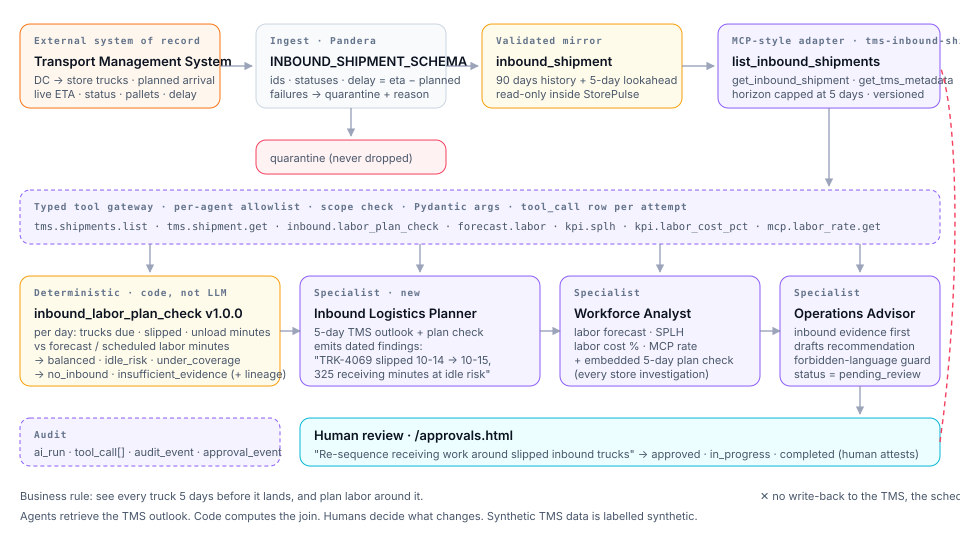
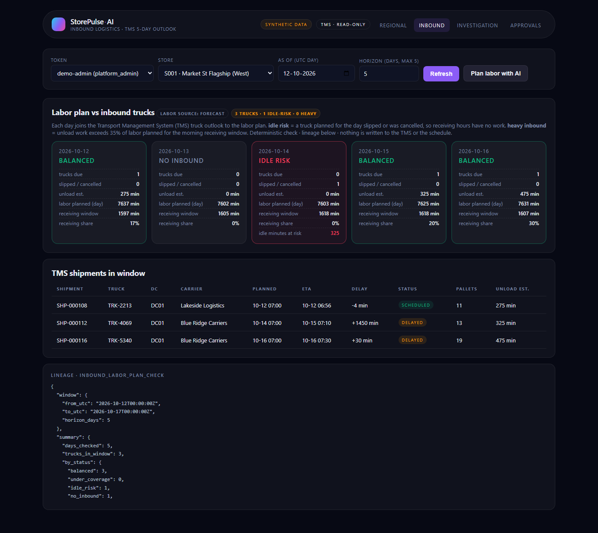
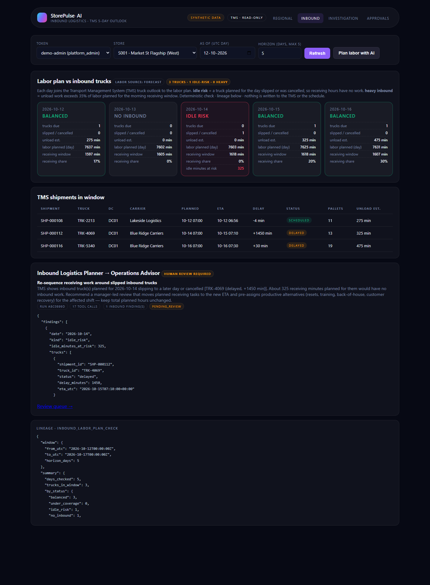
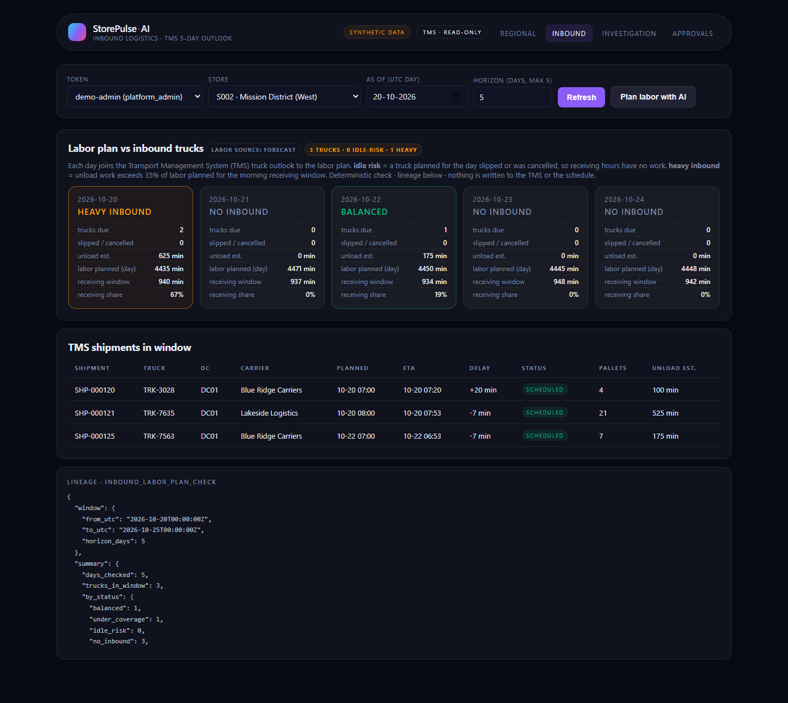
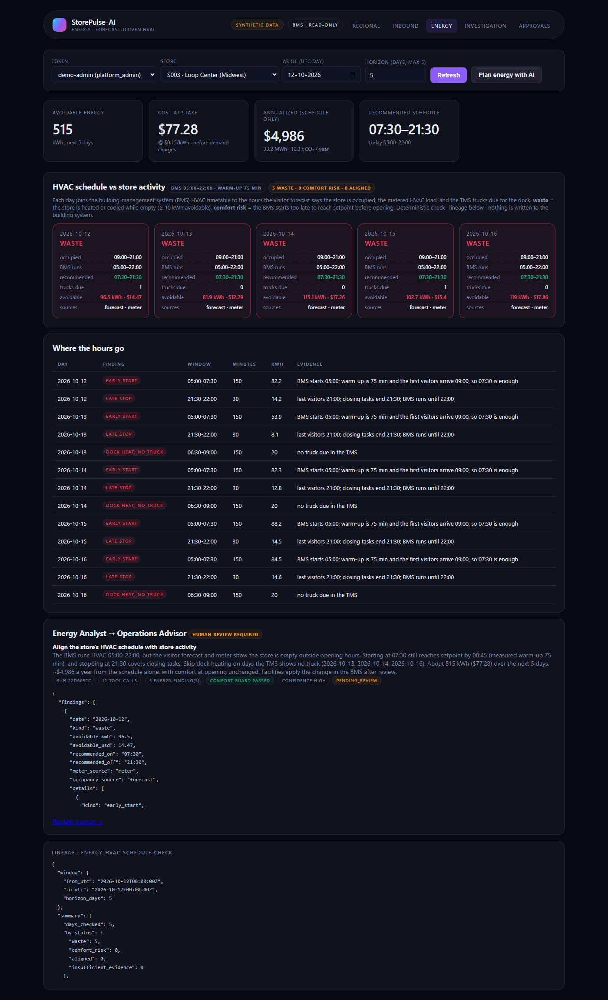

# StorePulse-AI

> **AI-Powered Store Operations · Workforce Intelligence · Decision Platform**
> Governed, evidence-first decision intelligence for multi-store retailers.

<p>
<a href="#test-results">253 tests · all passing</a> ·
<a href="#5-security-posture-owasp-aligned">OWASP-mapped controls</a> ·
<a href="#agentic-architecture">7 specialist agents + supervisor</a> ·
<a href="#tms-integration--inbound-labor-planning-v11">TMS inbound labor planning</a> ·
<a href="#forecast-driven-hvac--energy-v12">Forecast-driven HVAC</a> ·
<a href="#6-observability-logging--monitoring">JSON logs · Prometheus metrics</a> ·
<a href="#7-human-in-the-loop-approval-workflow">Human-approved recommendations</a>
</p>

---

## Table of contents

1. [Purpose](#1-purpose)
2. [Problem statement](#2-problem-statement)
3. [Proposed solution](#3-proposed-solution)
   - [TMS integration & inbound labor planning (v1.1)](#tms-integration--inbound-labor-planning-v11)
   - [Forecast-driven HVAC / energy (v1.2)](#forecast-driven-hvac--energy-v12)
   - [Screens: what problem each one solves](#screens-what-problem-each-one-solves)
4. [Architecture](#4-architecture)
   - [System diagram](#system-architecture)
   - [Agentic architecture](#agentic-architecture)
   - [Data flow](#data-flow)
   - [End-to-end project flow](#end-to-end-project-flow)
5. [Security posture (OWASP-aligned)](#5-security-posture-owasp-aligned)
6. [Observability, logging & monitoring](#6-observability-logging--monitoring)
7. [Human-in-the-loop approval workflow](#7-human-in-the-loop-approval-workflow)
8. [Automation & orchestration](#8-automation--orchestration)
9. [API reference](#9-api-reference)
10. [Local setup — run everything in 5 minutes](#10-local-setup)
11. [Testing & quality](#11-testing--quality)
12. [Repository layout](#12-repository-layout)
13. [Technology choices](#13-technology-choices)
14. [Honest status & known gaps](#14-honest-status--known-gaps)
15. [Roadmap](#15-roadmap)

---

## 1. Purpose

**StorePulse-AI is a governed *decision-support* platform — not an autonomous scheduler or employee-management authority.**

It unifies fragmented store, workforce, and operations data into a trusted analytics core and layers constrained agentic workflows on top. Every recommendation carries its evidence, its assumptions, and a human reviewer. Deterministic code handles math; large language models only summarise verified evidence.

> **Product promise.** Move store teams from *"what happened?"* to *"what's likely next, why, and what should we consider doing"* — with every claim traceable to its data, its time window, and the reviewer who approved it.

---

## 2. Problem statement

Multi-store retailers run on data that never meets in one place. A regional manager overseeing 40 stores typically touches **6+ systems before 9am** — POS, workforce management, inventory, labor-budget sheets, exception emails, BI dashboards — then reconciles the gaps in a spreadsheet. The data exists. **The decision window does not.**

| # | Fragmentation | Operational cost |
|---|---|---|
| 1 | Sales, labor, footfall, inventory in separate systems | Managers reconcile in spreadsheets — no trusted unified picture by 9am |
| 2 | Dashboards are descriptive, not diagnostic | The same "why" questions are re-asked every week |
| 3 | Static staffing plans built on weekly averages | Peak periods lose conversion; trough periods carry excess hours |
| 4 | Anomalies surface at month-end | By the time a manager hears about it, the week, promo, or season is over |
| 5 | **Three teams, three versions of "sales per labor hour"** | Decision cycles stall on definitional debates |
| 6 | DC truck ETA not joined to shift plan | Labor arrives, inventory doesn't; paid idle hours leak out as a silent tax |
| 7 | Forecasts ignore weather, events, local news | Lost sales on surge days, paid idle labor on collapse days |
| 8 | Customer sentiment measured by occasional NPS | Frustrated shoppers go unnoticed until review/return/churn |
| 9 | HVAC runs on a fixed timetable, not on store activity | The building is heated or cooled for hours while empty; one monthly bill hides it |

StorePulse-AI's v1.0 attacks items **1–5** head-on with a trusted metric layer, constrained agents, and a review queue. **v1.1 closes item 6** by joining the TMS 5-day truck outlook to the labor plan ([details](#tms-integration--inbound-labor-planning-v11)). **v1.2 closes item 9** by checking the HVAC timetable against the visitor forecast ([details](#forecast-driven-hvac--energy-v12)). Items 7–8 are explicit future scope.

---

## 3. Proposed solution

A **modular monolith** with clean architecture and a strict trust boundary around the AI runtime. Capabilities land in sequence:

| Capability | Status |
|---|---|
| Regional command center (8 KPIs with lineage) | ✅ v1.0 |
| Workforce demand forecast (seasonal baseline + WAPE/MAE) | ✅ v1.0 |
| Anomaly & exception feed (robust z-score + thresholds, evidence) | ✅ v1.0 |
| Evidence-first agentic investigation (specialists + supervisor) | ✅ v1.0 |
| Daily store manager briefing | ✅ v1.0 |
| Human review & approval workflow | ✅ v1.0 |
| Audit trail, metric catalog, model versioning | ✅ v1.0 |
| MCP labor-rate reference server (in-process adapter) | ✅ v1.0 |
| **TMS integration & inbound labor planning** (5-day truck outlook ↔ labor plan, 6th specialist) | ✅ v1.1 |
| **Forecast-driven HVAC / energy** (BMS schedule ↔ visitor forecast, meter, trucks; 7th specialist) | ✅ v1.2 |
| Live TMS / BMS vendor APIs · external signals (weather/events) · camera sentiment | ⏳ future |

Design pillars ("principles that shape every build decision"):

1. **Deterministic where it counts.** SQL, KPI math, validation, forecasts are code — never LLM calls.
2. **Evidence or silence.** Every finding cites the metric, window, and source. Insufficient data returns `null`, never a fabricated number.
3. **Read-only by default.** No schedule, employee, or payroll mutation. Recommendations route to a human reviewer.
4. **Least-privilege tools.** Agents reach the world only through a typed, allowlisted gateway. Tool descriptions aren't security — authorization is.
5. **Responsible workforce AI.** No individual employee scoring, ranking, or surveillance. Forecasts estimate workload, not punish people.
6. **Honest status.** Synthetic data is labeled synthetic. Opportunity estimates are labeled estimates. Compliance claims require independent assessment.

### TMS integration & inbound labor planning (v1.1)

**The problem.** Store labor plans are built days ahead, but DC trucks slip, arrive early, or get cancelled. When a truck slips, receiving hours are paid for with nothing to unload. When two heavy loads land on the same morning, the plan can't absorb them and the floor goes uncovered. The Transport Management System (TMS) knows about the slip. The labor plan doesn't.

**What v1.1 adds.** StorePulse mirrors the TMS feed read-only and joins it, per store and per day, to the labor plan for the next 5 days.



| Piece | Where | What it does |
|---|---|---|
| TMS feed → validation → mirror | [`scripts/generate_data.py`](scripts/generate_data.py), [`packages/validation/schemas.py`](packages/validation/schemas.py) | Synthetic TMS feed (144 shipments on seed 42). A Pandera contract (unique shipment ids, `delay_minutes == eta − planned`, status enum) quarantines bad rows with a reason code before they reach the `inbound_shipment` table. |
| TMS adapter (MCP-style) | [`services/tms_mcp/server.py`](services/tms_mcp/server.py) | Read-only tools `list_inbound_shipments` and `get_inbound_shipment`. The look-ahead is hard-capped at **5 days** (`STOREPULSE_TMS_HORIZON_DAYS`). StorePulse never writes to the TMS. |
| `inbound_labor_plan_check` | [`packages/inbound_planning/service.py`](packages/inbound_planning/service.py) | Deterministic per-day join of trucks to planned labor. Returns a status per day with a full lineage block (formula, assumptions, thresholds, source rows). |
| Inbound Logistics Planner (6th specialist) | [`packages/ai_orchestration/agents/inbound_logistics.py`](packages/ai_orchestration/agents/inbound_logistics.py) | Calls `tms.shipments.list` → `inbound.labor_plan_check` → `forecast.labor` through the tool gateway and explains where trucks and labor disagree. It never computes the join itself (ADR-0014). |
| `plan_inbound_labor` workflow | [`packages/ai_orchestration/supervisor.py`](packages/ai_orchestration/supervisor.py) | Inbound planner (3 tool calls) → Store Performance (9) → Workforce (5) → Operations Advisor → a `pending_review` recommendation in the approval queue. 17-step evidence trail, one `ai_run` + audit event. |
| API + Inbound screen | [`apps/api/routers/inbound.py`](apps/api/routers/inbound.py), [`apps/api/static/inbound.html`](apps/api/static/inbound.html) | Shipments, the 5-day plan check, and a one-click AI plan. |

**Day statuses** returned by the check:

| Status | Rule |
|---|---|
| `idle_risk` | A truck planned for this day slipped to another day or was cancelled, so receiving hours are planned with nothing to unload. |
| `under_coverage` | Heavy day: unload minutes ÷ labor planned in the 09:00–12:00 receiving window > **35%**. |
| `balanced` | Trucks are due and the receiving window can absorb them. |
| `no_inbound` | No trucks due. |
| `insufficient_evidence` | No labor plan for the day. The check returns this instead of guessing. |

Same-day slips of 2 h or more are attached as `late` evidence. Labor comes from the published labor-minute forecast and falls back to scheduled `labor_hours`.

**The Inbound screen** (`/inbound.html`):

| 5-day board | AI inbound plan | Heavy-day detail |
|---|---|---|
|  |  |  |

**Guardrails.** The workflow is read-only on both the TMS and the schedule. It estimates workload and never names, ranks, or schedules an individual employee. Every recommendation goes to a human reviewer. Design rationale: [ADR-0013 and ADR-0014](docs/DECISIONS.md).

### Forecast-driven HVAC / energy (v1.2)

**The problem.** HVAC is usually the largest energy load in a non-food store, and it runs on a timetable set when the store opened, not on when customers and deliveries actually arrive. At the demo flagship the rooftop units start at 05:00, the floor is warm by 06:15, the doors open at 09:00, and the system runs until 22:00, an hour after close. The dock is heated for a 07:00 truck even on days the TMS already shows the truck has slipped. That is about **3 hours a day of conditioning an empty store**. Facilities see one monthly bill per store, so nobody connects the schedule to the traffic forecast the business already has.

**What v1.2 adds.** StorePulse mirrors each store's building-management system (BMS) read-only and checks its HVAC timetable, hour by hour, against the visitor forecast, the energy meter and the TMS truck schedule. The same forecast that plans labor and receiving now plans the building.

**What it saves**

| | Illustrative (stakeholder deck) | Measured on seed-42 synthetic data |
|---|---|---|
| Basis | ~40 kW HVAC, 3 avoidable hours a day, $0.15/kWh, 365 days | Metered kWh, `run_energy_check`, 5-day window from 2026-10-12 |
| Per store per day | ~120 kWh ≈ **$18** | S003 Loop Center (Chicago): ~88 kWh/day from the schedule, plus dock heat on no-truck days |
| Per store per year | **~$6.6K**, ~44 MWh, ~16 t CO₂ | S003: **~$5.0K**, 33 MWh, 12 t CO₂ |
| Five stores per year | ~$33K | **~$9.7K** (S002's schedule is already close to right) |
| 40-store region per year | **~$263K** | — |

Both columns count the schedule only. Dock-heating savings on slipped-truck days and peak-demand charges are extra. The pilot replaces the assumptions with each store's metered baseline. The case for the feature is in the stakeholder briefing ([`StorePulse-AI_Stakeholder_Briefing.pptx`](StorePulse-AI_Stakeholder_Briefing.pptx), slides 6–7, and [`docs/architecture.html`](docs/architecture.html)).

| Piece | Where | What it does |
|---|---|---|
| BMS feed → validation → mirror | [`scripts/generate_data.py`](scripts/generate_data.py), [`packages/validation/schemas.py`](packages/validation/schemas.py) | Synthetic HVAC timetable per store plus hourly meter readings (10,800 rows on seed 42). Pandera contracts quarantine reversed schedules, HVAC kWh above total kWh, and implausible temperatures. |
| BMS adapter (MCP-style) | [`services/bms_mcp/server.py`](services/bms_mcp/server.py) | Read-only tools `get_hvac_schedule` and `list_energy_readings` (history capped at 14 days). There is no write tool: facilities apply an approved change in the BMS. |
| Visitor forecast | [`packages/forecasting/service.py`](packages/forecasting/service.py) | New forecast kind `visitors`, the same seasonal model as labor. It defines the occupied hours. |
| `energy_hvac_schedule_check` | [`packages/energy_planning/service.py`](packages/energy_planning/service.py) | Deterministic per-day join. Recommended start = doors open − 15 min − the store's measured warm-up (p90); stop = close + 30 min. Early-start hours are priced at the metered holding load, late-stop hours from the meter, dock heating when the TMS shows no truck. Full lineage block. |
| Energy Analyst (7th specialist) | [`packages/ai_orchestration/agents/energy_analyst.py`](packages/ai_orchestration/agents/energy_analyst.py) | The only agent allowed to read the BMS. Calls `bms.hvac_schedule.get` → `energy.hvac_schedule_check` → `kpi.visitors` through the gateway. |
| `plan_store_energy` workflow | [`packages/ai_orchestration/supervisor.py`](packages/ai_orchestration/supervisor.py) | Energy Analyst (3 tool calls) → Store Performance (9) → Operations Advisor, which re-checks comfort before drafting a `pending_review` recommendation. |
| API + Energy screen | [`apps/api/routers/energy.py`](apps/api/routers/energy.py), [`apps/api/static/energy.html`](apps/api/static/energy.html) | Schedule, 5-day HVAC check, and "Plan energy with AI". |

**Day statuses** returned by the check:

| Status | Rule |
|---|---|
| `waste` | Early start + late stop + dock heating without a truck ≥ **10 kWh** avoidable. |
| `comfort_risk` | The BMS starts too late to reach setpoint before the doors open. The recommendation is to start *earlier*. |
| `aligned` | The timetable matches store activity. |
| `insufficient_evidence` | No visitor forecast or traffic, no meter data, or no BMS schedule. The check returns this instead of guessing. |

**The live Energy screen** (`/energy.html?store=S003&asof=2026-10-12&plan=1`):



**Guardrails.** Comfort at opening and food safety are hard constraints: the advisor's comfort guard verifies that the recommended start plus the measured warm-up reaches setpoint before opening on every checked day, or it does not recommend the change. Nothing is written to the building system, and every recommendation goes to a human reviewer. The check is about the building and never names, ranks, or monitors an employee. Design rationale: [ADR-0015](docs/DECISIONS.md).

### Screens: what problem each one solves

The clickable prototypes in [`docs/screens/`](docs/screens/) follow one story. **Alex Chen**, regional manager for Chicago Metro (5 stores), opens the morning briefing: Store #042 (Downtown Chicago) missed its sales target by 8.4% despite normal footfall. Each screen takes Alex one step further, from regional signal to store, to root cause, to labor and inbound-truck planning, to a human-approved action. Every claim on the way is tied to evidence.

Open [`docs/screens/index.html`](docs/screens/index.html) in a browser to click through it, or [`docs/screens/tour.html`](docs/screens/tour.html) for a 65-second auto-playing tour. Neither needs a server.

| # | Screen | Problem it solves ([§2](#2-problem-statement)) | Before | With StorePulse-AI |
|---|---|---|---|---|
| 01 | **Regional command center** · [prototype](docs/screens/regional.html) | **Fragmented visibility** (#1) and **three versions of SPLH** (#5) | Sales from POS, labor from workforce management, footfall from traffic counters, each in a different tab and reconciled by hand. Teams argue over whose number is right. | One governed view of all 5 stores: net sales vs target, transactions, average transaction value, labor cost %, sales per labor hour. Every KPI comes from one central metric catalog. Stores needing attention (#042, #211) are ranked, with a link to the open anomaly. |
| 02 | **Store performance** · [prototype](docs/screens/store.html) | **Reactive management**: dashboards describe but don't diagnose (#2) | The manager waits for a week-end PDF and then asks "why?" | Store #042 shows what moved yesterday by department and by hour, with a 30-day trend against target. Anomalies are already surfaced with their evidence (conversion −23 pp in Electronics, Tue 10am–2pm). |
| 03 | **Root-cause investigation** · [prototype](docs/screens/anomaly.html) | **Late signals and opaque root cause** (#2, #4) | The manager calls four people to piece a story together, and the week is over before anyone knows why. | A bounded, audited agent run ranks contributing factors with confidence scores and cited sources: a POS register error spike, a 2-associate coverage gap, and external causes ruled out. It lists alternative explanations it considered, then makes one reviewable recommendation (REC-5518) that names no employee. |
| 04 | **Workforce intelligence** · [prototype](docs/screens/workforce.html) | **Workforce mismatch**: static staffing built on weekly averages (#3) | Weekly averages hide the hourly peaks, so conversion is lost at the peak and paid hours sit idle in troughs. | An hourly forecast vs scheduled vs actual coverage chart exposes the recurring Tue 10am–2pm −1.8 FTE gap. The model is scored against a seasonal baseline (WAPE/MAE/RMSE), and what-if scenarios are priced with the approved labor-rate reference. It forecasts workload, not people, and never changes a schedule. |
| 05 | **Daily briefing & approvals** · [prototype](docs/screens/briefing.html) | **Slow decision cycles and trust gaps** (#4) | Five report tabs before 9am, and AI output nobody can verify. | One evidence-linked morning read: yesterday in review, 3 priorities, workforce observations, and an explicit *"what this briefing does **not** say"* block. Data caveats are listed. The approval queue is on the same page, and every decision is audited. |
| 06 | **Inbound logistics (TMS)** · [prototype](docs/screens/inbound.html) | **DC truck ETA not joined to the shift plan** (#6) | On Monday the TMS knows Thursday's truck will slip to Friday. The store finds out on Thursday at 7am, after the receiving crew has clocked in. | The 5-day truck outlook is joined to the labor plan for each day. A slipped truck becomes an *idle-risk* day (325 receiving minutes at risk), and a double-trailer Saturday becomes a *heavy inbound* day (67% of the receiving window). The agent proposes re-sequencing receiving work, with total planned hours unchanged, before the day starts. |
| 07 | **Energy (forecast-driven HVAC)** · [prototype](docs/screens/energy.html) | **HVAC runs on a fixed timetable, not on store activity** (#9) | The HVAC starts at 05:00 and runs until 22:00 on a 2011 timetable. The store is warm by 06:15 but opens at 09:00, and the dock is heated for a truck that slipped. One monthly bill hides all of it. | The BMS timetable is checked hour by hour against the visitor forecast, the meter and the TMS. Three empty hours a day become a priced finding (140 kWh, $21 that day; ~$6.6K a year) and a comfort-guarded schedule change (07:30–21:30) for a human to approve. |

The prototypes use an illustrative scenario (Store #042, Nov 2026, illustrative model versions and scores). The live build uses the seed-42 synthetic dataset (stores S001–S005), so the numbers differ by design.

**Prototype → live build.** Five of the seven screens run today against the real API (`python -m uvicorn apps.api.main:app`). The rest have their API in place and are waiting for the M8 React frontend.

| Prototype | Live screen ([`apps/api/static/`](apps/api/static/)) | API behind it |
|---|---|---|
| 01 Regional | ✅ [`index.html`](apps/api/static/index.html): 8 KPI tiles with lineage, per-token scope | `/api/v1/kpi/*` |
| 02 Store | ⏳ prototype only | `/api/v1/kpi/*`, `/api/v1/anomalies` |
| 03 Investigation | ✅ [`investigation.html`](apps/api/static/investigation.html): agent run, per-specialist output, audit trail | `/api/v1/agents/investigate-*`, `/api/v1/audit` |
| 04 Workforce | ⏳ prototype only | `/api/v1/stores/{id}/workforce/forecast` |
| 05 Briefing & approvals | ✅ approvals part: [`approvals.html`](apps/api/static/approvals.html) (approve / reject / start / complete) · ⏳ briefing view | `/api/v1/recommendations*`, `/api/v1/agents/briefing` |
| 06 Inbound (TMS) | ✅ [`inbound.html`](apps/api/static/inbound.html): 5-day board, shipments, "Plan labor with AI" | `/api/v1/stores/{id}/inbound/*`, `/api/v1/agents/plan-inbound-labor` |
| 07 Energy (HVAC) | ✅ [`energy.html`](apps/api/static/energy.html): savings tiles, 5-day board, findings, "Plan energy with AI" | `/api/v1/stores/{id}/energy/*`, `/api/v1/agents/plan-store-energy` |

Problems #7 (weather/events/news) and #8 (customer sentiment) have no screen yet; they are roadmap items M9 and M11. The stakeholder briefing [`docs/architecture.html`](docs/architecture.html) gives the full problem framing, architecture, and guardrails behind these screens.

---

## 4. Architecture

### System architecture


Four logical layers in a single deployable:

- **Presentation** — static HTML screens today (React+Vite from M8). Five live screens: Regional, Inbound (TMS), Energy (HVAC), Investigation, Approvals. Seven clickable prototypes in `docs/screens/` ([what each solves](#screens-what-problem-each-one-solves)).
- **API & Application** — FastAPI `/api/v1`, Pydantic contracts, demo bearer auth, RBAC + region/store scope on every endpoint, correlation IDs, structured errors.
- **Core pillars**
  - *Analytics* — 8 KPIs with central metric catalog + lineage. Forecasting (seasonal baseline). Anomaly detection (robust z-score + thresholds).
  - *AI orchestration* — supervisor + 7 specialists. Typed tool gateway with per-agent allowlists. Deterministic LLM provider (production provider pluggable).
  - *Governance* — audit event stream, approval workflow, metric/prompt/model versioning.
- **Data layer** — SQLAlchemy on SQLite (ANSI-SQL; Postgres swap in M7). Pandera validation at ingest, quarantine with reason codes.
- **External · MCP adapter** — read-only Labor Rate Reference server exposing `get_labor_rate`, `list_labor_rate_regions`, `get_labor_rate_metadata`.
- **Observability** — structured JSON logs, correlation IDs, Prometheus-text `/metrics` with counters and summaries.

### Agentic architecture


**Supervisor-orchestrated workflow with narrowly scoped specialists.** Agents retrieve. Humans decide.

1. **Request** → authenticated, scope-checked, correlation-stamped.
2. **Supervisor** → classifies intent (`store_investigation`, `anomaly_investigation`, `daily_briefing`), applies step/token/time budgets.
3. **Specialists** — each has its own allowlist:

   | Agent | Role | Allowlisted tools |
   |---|---|---|
   | `store_performance` | Retrieves store KPIs vs comparable period | `kpi.*`, `stores.list` |
   | `workforce` | Reads labor forecast + MCP labor-rate; explains cost assumptions | `forecast.labor`, `kpi.labor_cost_pct`, `mcp.labor_rate.get` |
   | `anomaly_investigator` | Pulls anomaly detail, ranks evidence-cited hypotheses (correlation, not causation) | `anomaly.*`, `kpi.*`, `forecast.labor` |
   | `operations_advisor` | Composes a pending-review recommendation; policy guard blocks forbidden language | synthesises from upstream agents' output |
   | `briefing` | Composes a daily manager briefing; LLM narrates verified evidence only | `kpi.*`, `anomaly.list`, `forecast.labor` |

4. **Typed tool gateway** validates args against Pydantic schemas, enforces the allowlist and the principal↔store scope, times every call, writes a `tool_call` row for every attempt (success, denied, or error).
5. **Evidence check** → every output is schema-validated; recommendations are pattern-checked for forbidden language ("cut hours", "layoff", …) before persistence.
6. **Human review** → recommendations land in the `pending_review` queue. Only `platform_admin`, `regional_manager`, and `ops_reviewer` roles can approve or reject.
7. **Audit** → `ai_run` + `tool_call` + `audit_event` rows persist for every workflow, with model and prompt versions recorded.

**Agentic loop (pseudocode)**

```python
def investigate_store(ctx, store_id, from_utc, to_utc):
    budget = RunBudget(max_steps=20, max_tokens=2000, timeout_s=20.0)
    run_id = new_id(); step = 0; tokens = 0

    sp = store_performance.run(ctx, run_id, store_id, from_utc, to_utc)
    step = sp.last_seq; budget.check(step, tokens, elapsed)

    wf = workforce.run(ctx, run_id, store_id, from_utc, to_utc, region,
                       start_seq=step)
    step = wf.last_seq; budget.check(step, tokens, elapsed)

    advisor = operations_advisor.run(ctx, run_id, sp, wf, start_seq=step)
    # Advisor produces a draft recommendation; policy guard runs inside.

    persist_ai_run(run_id, step, tokens, output={sp, wf, advisor})
    record_audit(actor=ctx.principal.subject, action="ai_run.store_investigation")
    emit_metric("storepulse_agent_runs_total", intent="store_investigation",
                status="ok")
    create_recommendation(advisor.recommendation, status="pending_review")
    return run_id, advisor.recommendation
```

### Data flow


Every KPI response carries a **lineage** block so the number is defensible:

```json
{
  "value": 13.4171,
  "unit": "USD per labor hour",
  "window": { "from_utc": "2026-09-24T00:00:00Z", "to_utc": "2026-10-01T00:00:00Z" },
  "lineage": {
    "metric_name": "sales_per_labor_hour",
    "metric_version": "1.0.0",
    "formula": "sum(net_sales_cents)/100.0 / nullif(sum(labor_minutes)/60.0, 0)",
    "source_tables": ["sales_txn", "labor_hours"],
    "row_counts": { "sales_txn": 84, "labor_hours": 84 },
    "assumptions": [
      "Net sales exclude tax; stored in integer cents.",
      "Window is half-open [from_utc, to_utc); times in UTC."
    ],
    "synthetic_data": true
  },
  "status": "ok"
}
```

### End-to-end project flow

A single trip through the platform, from a cold clone to a reviewer approving a recommendation. Each step names the real file so the narrative is reconstructable in code.

**Stage A · Offline data preparation** *(one-shot, deterministic)*

1. **Generate synthetic facts.** [`scripts/generate_data.py`](scripts/generate_data.py) seeds `numpy.default_rng(seed)` and writes 5 stores × 90 days of sales, labor, and traffic CSVs under `data/synthetic/`, plus a `_SYNTHETIC_DATA.txt` marker and `SYNTHETIC_VERSION = "synthetic-v1"`. The same seed produces byte-identical output — tests depend on this.
2. **Validate and load.** [`scripts/load_db.py`](scripts/load_db.py) resets the 12 tables in dependency order, then streams each CSV through [`packages/validation/schemas.py`](packages/validation/schemas.py) (Pandera, pinned 0.20.4). Clean rows land in the fact tables; bad rows land in `quarantine` with a `reason_code` and the raw payload — never dropped. Pandera runs **once at ingest**, never on the API hot path (ADR-0003).
3. **Seed the catalogs.** The loader inserts 8 rows into `metric_catalog` (name, version, formula, source tables, assumptions) and 8 rows into `labor_rate` via the MCP server's `seed_rates()`. The metric catalog is the authority every KPI call checks its lineage envelope against.
4. **Compute offline artefacts.** [`scripts/run_forecast.py`](scripts/run_forecast.py) trains the seasonal baseline (`seasonal_baseline_dow_hour_trimmed_mean v1.0.0`) on an 80% time split and writes `forecast_run` + `forecast` rows (never a random split). [`scripts/run_anomalies.py`](scripts/run_anomalies.py) runs the robust-z detector and writes `anomaly` rows with evidence. All four scripts are re-runnable; the pipeline is a function of the seed.

**Stage B · Live request** *(a reviewer clicks "Investigate S001")*

5. **Request lands at FastAPI.** `POST /api/v1/agents/investigate-store` hits [`apps/api/main.py`](apps/api/main.py). Two middlewares run first: a correlation middleware assigns/propagates `X-Correlation-Id` and binds it to the logging thread-local; a metrics middleware increments `http_requests_total{route,method,status}` and records latency into a histogram.
6. **Authentication + scope.** [`apps/api/security.py`](apps/api/security.py) reads the bearer token, resolves it to a `Principal` (role + allowed regions/stores), then `ensure_store_access(principal, "S001")` fails closed if scope doesn't match. This is what defeats BOLA/BFLA in `tests/integration/test_api_kpis_and_security.py` — a West regional cannot read `S002` even by guessing the ID.
7. **Supervisor opens a run.** [`packages/ai_orchestration/supervisor.py`](packages/ai_orchestration/supervisor.py) writes an `ai_run` row (`status=running`, correlation ID, prompt + model versions) and constructs a `RunBudget(max_steps=20, max_tokens=2000, timeout_s=20.0)`. If any budget is exceeded, the run is marked `aborted` and the partial evidence is preserved.

**Stage C · Agents assemble evidence** *(specialists in sequence, each confined)*

8. **`store_performance` runs first.** It asks the typed tool gateway ([`packages/tool_gateway/gateway.py`](packages/tool_gateway/gateway.py)) for `kpi.net_sales`, `kpi.atv`, `kpi.upt`, `kpi.conversion_rate` over the window. For **each** call the gateway does, in strict order:
   - Allowlist check (ADR-0010 — is `store_performance` allowed to call this tool?),
   - Scope check (does the principal have access to this store/region?),
   - Pydantic input validation,
   - Execute the KPI function from [`packages/analytics/kpi_service.py`](packages/analytics/kpi_service.py),
   - Pydantic output validation,
   - Write a `tool_call` row (tool name, args, status `ok`/`denied`/`error`, duration ms, correlation ID).
9. **`workforce` runs next.** Calls `kpi.splh`, `kpi.labor_cost_pct`, `forecast.labor`, and `mcp.labor_rate.get`. The last one goes through [`services/labor_rate_mcp/server.py`](services/labor_rate_mcp/server.py) — an in-process MCP-shaped adapter (ADR-0008). Agents never call it directly; the gateway mediates, so swapping the transport to the MCP SDK in M7 is below the agent code.
10. **`anomaly_investigator` runs if signals exist.** Calls `anomaly.list` + `anomaly.detail`, correlates with KPI drifts, and ranks hypotheses — always as correlation, never causation.
11. **Every tool response carries lineage.** No endpoint returns a bare number. Each KPI result is wrapped in a lineage envelope (metric name, version, formula, window, source tables, row counts, assumptions, `synthetic_data: true`). This is what makes a reviewer able to defend a number six months later.

**Stage D · The LLM composes narrative — without inventing**

12. **Deterministic provider by default.** [`packages/ai_orchestration/llm_provider.py`](packages/ai_orchestration/llm_provider.py)'s `DeterministicProvider` takes the structured `evidence` dict the agents assembled and renders a human-readable summary **from a fixed template** (ADR-0007). There is no path for it to fabricate a figure, because it never generates — it substitutes. This is the exact property `tests/security/test_prompt_injection.py` relies on: a hostile user message cannot change the output, because the output is a template over structured evidence. Swapping in Anthropic/OpenAI/Bedrock is one line in `apps/api/dependencies.get_api_llm()`.
13. **`operations_advisor` drafts the recommendation.** It composes title + rationale + proposed action from the upstream agents' output, then [`_policy_check`](packages/ai_orchestration/agents/operations_advisor.py) scans for forbidden language (ADR-0011): `cut hours`, `reduce hours`, `layoff`, `lower pay`, etc. On a match, the draft is rewritten to a safe "hold current plan" default and the violation is recorded. This is a belt-and-braces guard — even a future misbehaving LLM cannot leak unsafe wording into the approval queue.

**Stage E · Human-in-the-loop** *(the hard stop before any operational change)*

14. **Recommendation enters the queue.** The supervisor inserts a `recommendation` row in state `draft` → [`packages/governance/approval_workflow.py`](packages/governance/approval_workflow.py) advances it to `pending_review`. Both transitions write an `approval_event` (from, to, actor, comment) **and** an `audit_event` (append-only, correlation-ID stamped). The response returns `recommendation_id`, `state="pending_review"`, the evidence step count, the narrative, and the lineage envelopes.
15. **Reviewer decides.** Someone opens `/approvals.html`, reads the evidence, and POSTs to `/api/v1/recommendations/{id}/approve` or `/reject`. The state machine (`ALLOWED_TRANSITIONS`) enforces that:
    - only `platform_admin`, `regional_manager`, `ops_reviewer` can approve or reject,
    - store managers can read recommendations for their store but cannot approve,
    - `rejected` is terminal,
    - any illegal transition raises `InvalidTransition` and writes nothing.
16. **Execution is a human attestation in v1.0.** `approved → in_progress → completed` are state updates recording that a human carried out the action in the real operational system. The platform does **not** write to any POS, scheduler, or payroll system. Read-only / recommendation-only is the initial release contract, not a TODO.

**Stage F · Observability runs through every step**

17. **One JSON log line per event**, each stamped with the same correlation ID — HTTP request, each tool call, every state transition. [`packages/observability/logging.py`](packages/observability/logging.py) uses only stdlib (ADR-0012). A single investigate-store call produces a traceable chain roughly 15 lines long.
18. **Metrics at `GET /metrics`.** Prometheus text exposition — counters for HTTP requests, agent runs by intent and status, tool calls by agent/tool/status, approval transitions; quantile summaries (p50/p90/p99) for HTTP and tool latency. Grafana is a config change in M6.
19. **Audit is the primary record.** Every operational fact — who ran what, what the agent asked, what the tool returned, who approved — is reconstructable from `ai_run` + `tool_call` + `approval_event` + `audit_event` alone. If the UI vanished, the data story would still be whole.

**Request → response, in one picture**

```
HTTP POST /api/v1/agents/investigate-store  { store_id:"S001", window_hours:72 }
Authorization: Bearer demo-admin

  1 · correlation mw        → X-Correlation-Id = c-9f2a...
  2 · metrics mw            → http_requests_total{route=...}  ++
  3 · auth + scope          → principal=platform_admin, scope ok
  4 · supervisor opens run  → ai_run row  (status=running)
  5 · store_performance     → 4 tool calls (net_sales, atv, upt, conversion)
  6 · workforce             → 3 tool calls (splh, labor_cost_pct, mcp.labor_rate)
  7 · anomaly_investigator  → 2 tool calls (anomaly.list, anomaly.detail)
  8 · DeterministicProvider → narrative from evidence  (template, not generation)
  9 · operations_advisor    → draft recommendation + policy check (passes)
 10 · workflow.transition   → draft → pending_review  (+ approval_event + audit_event)
 11 · supervisor closes run → ai_run (status=success, steps=13, duration=106ms)
 12 · response 200          → { recommendation_id, state:"pending_review", summary, lineage[] }

Reviewer opens /approvals.html → POST /recommendations/{id}/approve
  → approved → in_progress → completed   (each step: approval_event + audit_event)
```

**What the architecture refuses, by design**

- No bare numbers. No invented facts. No unilateral action. No cross-scope reads. No global tool access. No individual-employee scoring, ranking, or surveillance. No unsafe action language. No chain-of-thought exposure. No secrets in code.

Each refusal is enforced in code and covered by a test under `tests/security/` or `tests/integration/`.

---

## 5. Security posture (OWASP-aligned)

Controls implemented today, mapped to OWASP taxonomies (full matrix in [`docs/OWASP_CONTROL_MAPPING.md`](docs/OWASP_CONTROL_MAPPING.md) once scanned — in v1.0 the controls themselves ship; the formal mapping sign-off is M6):

| OWASP item | How it's addressed in v1.0 |
|---|---|
| **API #1 — Broken Object Level Authorization (BOLA)** | Every KPI / forecast / anomaly / recommendation endpoint resolves store → region and calls `ensure_store_access(principal, store_id, region)`. Covered by regression tests `test_west_manager_cannot_see_s002`, `test_s001_manager_cannot_see_s002`. |
| **API #5 — Broken Function Level Authorization (BFLA)** | Approval endpoint requires one of `{platform_admin, regional_manager, ops_reviewer}`. Store managers get 403 on `/recommendations/:id/review` — tested. |
| **API #2 — Broken Authentication** | Bearer token on every request; missing/invalid token → 401. Zero endpoints anonymous beyond `/api/v1/health` and `/metrics`. |
| **API #3 — Broken Object Property Level Authorization** | Pydantic response models whitelist exactly what the client sees; no `model_dump()` of internal fields. Audit payload never contains raw prompts. |
| **Web #1 — Broken Access Control** | RBAC + resource-level scope enforcement centralized in `apps/api/security.py`. |
| **Web #3 — Injection** | 100% parameterized SQL via SQLAlchemy `text(...)` with bound params. No string interpolation into SQL anywhere. |
| **LLM #1 — Prompt Injection** | LLM provider receives only an **evidence dict**, never raw user text. The DeterministicProvider is literally a template that reads evidence keys — `test_injection_in_user_prompt_cannot_change_output` proves a hostile user prompt cannot alter output. |
| **LLM #2 — Sensitive Information Disclosure** | LLM output never contains secrets; prompts are never logged; `evidence_json` columns stay server-side. |
| **LLM #5 — Improper Output Handling** | Every agent output is schema-validated before persistence. The `operations_advisor` additionally runs a forbidden-language guard. |
| **LLM #6 — Excessive Agency** | No tool mutates state. Human approval required for every recommendation. The tool gateway enforces an **allowlist per agent**, not a global one. |
| **Agentic AI — Tool permission escalation** | Per-agent allowlist (see [`packages/tool_gateway/tools.py`](packages/tool_gateway/tools.py)). `test_tool_denied_when_outside_allowlist` proves the briefing agent cannot call `mcp.labor_rate.get`. |
| **Agentic AI — Unbounded loops** | Supervisor enforces `max_steps`, `max_tokens`, `timeout_s`. Exceeding any budget raises and the run is persisted with `status="error"`. |
| **Agentic AI — Audit** | Every workflow writes `ai_run`, `tool_call[]`, `audit_event`, and (when applicable) `approval_event` rows. Append-only tables; no UPDATE/DELETE from app code. |

### Responsible workforce AI

- No scoring, ranking, or surveillance of individual employees.
- Forecasts measure **workload demand**, not people.
- `operations_advisor` pattern-blocks forbidden phrasing: *cut hours · reduce hours · fire · terminate · layoff · lower pay*. Blocked drafts get rewritten to a safe "hold current plan" default.
- Labor rates come from the MCP server as a versioned reference, not a hard-coded constant — and they inform *cost assumptions*, never pay decisions.

### Honest limitations

- Demo bearer auth is for local use only. Real OIDC is a drop-in replacement for `authenticate()`.
- No TLS, CSRF, or CSP today — those land with the deployment configuration in M7.
- No dependency-scan CI yet. `pyproject.toml` pins versions; `pip-audit` integration is M6 scope.

---

## 6. Observability, logging & monitoring

### Structured JSON logging

Every log line is a single-line JSON object with correlation ID:

```json
{"ts":"2026-11-07T04:17:55.194Z","level":"INFO","logger":"storepulse.api",
 "cid":"97b9f0646282","msg":"http_request",
 "method":"GET","path":"/api/v1/kpi/splh","status":200,"duration_ms":6}
```

- Correlation ID is accepted on inbound `x-correlation-id` or generated server-side, then echoed in the response header.
- The `cid` propagates to agent runs, tool calls, audit events, and approval events (via `packages.observability.logging.set_correlation_id`).
- Prompts and raw tool arguments are **not** logged at `INFO`.

### Prometheus-text metrics

`GET /metrics` returns:

```
# HELP storepulse_http_requests_total Count of HTTP requests served.
# TYPE storepulse_http_requests_total counter
storepulse_http_requests_total{method="GET",path="/api/v1/kpi/splh",status="200"} 1.0
storepulse_agent_runs_total{intent="store_investigation",status="ok"} 1.0
storepulse_tool_calls_total{status="denied",tool="mcp.labor_rate.get"} 2.0
storepulse_tool_calls_total{status="ok",tool="kpi.splh"} 7.0
storepulse_kpi_requests_total{metric="splh"} 1.0
storepulse_http_request_ms_count{method="POST",path="/api/v1/agents/investigate-store"} 1.0
storepulse_http_request_ms_sum{method="POST",path="/api/v1/agents/investigate-store"} 106.0
storepulse_http_request_ms{method="POST",path="/api/v1/agents/investigate-store",quantile="0.9"} 106.0
```

### What to monitor

| Dimension | Metric |
|---|---|
| Traffic / latency | `storepulse_http_requests_total`, `storepulse_http_request_ms{quantile}` |
| KPI consumption | `storepulse_kpi_requests_total{metric}` |
| Agent health | `storepulse_agent_runs_total{intent,status}` |
| Governance | `storepulse_tool_calls_total{tool,status}` — spikes in `status="denied"` reveal scope-policy or allowlist attacks |
| Human review | `storepulse_recommendations_total{status}` — queue backlog alerts on `pending_review` growth |
| Data quality | Anomaly table size by severity; quarantine count by `source_dataset` |

Grafana dashboards + OpenTelemetry collector land in M6; the exposition format is already stable so the dashboards themselves are a config change.

---

## 7. Human-in-the-loop approval workflow


**Nothing moves in a source system.** Agents can only produce draft recommendations. Every recommendation walks this state machine:

```
draft -> pending_review -> approved | rejected
approved -> in_progress -> completed | expired
rejected -> (terminal)
```

- Roles that can approve/reject: `platform_admin`, `regional_manager`, `ops_reviewer`.
- Store managers can **view** scoped recommendations but not transition them.
- Every transition writes a row to `approval_event` **and** `audit_event`, both append-only, both stamped with the request's correlation ID.
- Invalid transitions return `409 Conflict`; forbidden roles return `403`; missing recommendations return `404`.

Try it from the UI at `http://localhost:8000/approvals.html`, or via the API:

```bash
curl -X POST -H "Authorization: Bearer demo-reviewer" \
  -H "Content-Type: application/json" \
  -d '{"decision":"approve","comment":"evidence looks reasonable"}' \
  http://localhost:8000/api/v1/recommendations/<rec_id>/review
```

---

## 8. Automation & orchestration

**Three one-command pipelines** make v1.0 reproducible from a clean clone:

```bash
python -m scripts.generate_data --seed 42 --days 90   # deterministic synthetic data
python -m scripts.load_db                             # Pandera-validated ingest + seed catalog
python -m scripts.run_forecast --horizon-days 14      # fit seasonal baseline + evaluate WAPE/MAE
python -m scripts.run_anomalies --days 30             # robust-zscore + coverage-gap detection
python -m scripts.run_inbound_check --as-of 2026-10-12  # TMS trucks ↔ labor plan, next 5 days per store
python -m scripts.run_forecast --kind visitors --horizon-days 14  # footfall forecast for the energy check
python -m scripts.run_energy_check                     # BMS HVAC timetable ↔ store activity, every store
```

Then start the service:

```bash
python -m uvicorn apps.api.main:app --port 8000
```

### Agent workflows

Six composable triggers — each agent run creates an `ai_run` with full audit trail:

| Trigger | Endpoint |
|---|---|
| Investigate a store (full KPI + workforce + advisor) | `POST /api/v1/agents/investigate-store` |
| Plan inbound receiving labor from the TMS 5-day outlook | `POST /api/v1/agents/plan-inbound-labor` |
| Align the HVAC schedule with store activity (BMS) | `POST /api/v1/agents/plan-store-energy` |
| Investigate a specific anomaly (hypothesis ranking) | `POST /api/v1/agents/investigate-anomaly` |
| Generate a daily store briefing | `POST /api/v1/agents/briefing` |
| Approve / reject / start / complete a recommendation | `POST /api/v1/recommendations/:id/review` |

### Budgets

The supervisor enforces three budgets on every run:

```python
RunBudget(max_steps=20, max_tokens=2000, timeout_s=20.0)
```

Blown budgets abort the run cleanly and persist `status="error"` with the reason. Nothing is left half-committed because every tool call is wrapped in its own transaction.

---

## 9. API reference

Full OpenAPI at `http://localhost:8000/docs`. Highlights:

**Ops**

| Method | Path | Purpose |
|---|---|---|
| GET | `/api/v1/health` | Liveness |
| GET | `/metrics` | Prometheus text exposition |

**Master data**

| Method | Path |
|---|---|
| GET | `/api/v1/stores` — scoped to principal |
| GET | `/api/v1/regions` |
| GET | `/api/v1/metric-catalog` |

**KPIs** (all return `{value, unit, window, lineage, status}`)

| GET | `/api/v1/kpi/{splh,net_sales,transactions,atv,upt,visitors,conversion_rate,labor_cost_pct}` |
|---|---|

**Forecast / anomaly**

| Method | Path |
|---|---|
| GET | `/api/v1/stores/{store_id}/workforce/forecast?from=&to=` |
| GET | `/api/v1/anomalies?store_id=&status=&limit=` |
| GET | `/api/v1/anomalies/{anomaly_id}` |

**Inbound (TMS)** — `horizon_days` is 1–5; anything larger returns 422

| Method | Path |
|---|---|
| GET | `/api/v1/stores/{store_id}/inbound/shipments?from=&to=` |
| GET | `/api/v1/stores/{store_id}/inbound/labor-plan?as_of=&horizon_days=` |

**Energy (BMS)** — `horizon_days` is 1–5; anything larger returns 422

| Method | Path |
|---|---|
| GET | `/api/v1/stores/{store_id}/energy/schedule` |
| GET | `/api/v1/stores/{store_id}/energy/hvac-check?as_of=&horizon_days=` |

**Agents**

| Method | Path |
|---|---|
| POST | `/api/v1/agents/investigate-store?store_id=&from=&to=` |
| POST | `/api/v1/agents/plan-inbound-labor?store_id=&as_of=&horizon_days=` |
| POST | `/api/v1/agents/plan-store-energy?store_id=&as_of=&horizon_days=` |
| POST | `/api/v1/agents/investigate-anomaly?anomaly_id=` |
| POST | `/api/v1/agents/briefing?store_id=&as_of_utc=` |

**Recommendations**

| Method | Path |
|---|---|
| GET | `/api/v1/recommendations?status=&store_id=` |
| GET | `/api/v1/recommendations/{id}` |
| POST | `/api/v1/recommendations/{id}/review` — body `{decision, comment}` |

**Audit** (platform_admin / ops_reviewer only)

| Method | Path |
|---|---|
| GET | `/api/v1/audit?actor=&target_type=&limit=` |

Demo bearer tokens:

| Token | Role | Scope |
|---|---|---|
| `demo-admin` | `platform_admin` | all regions, all stores |
| `demo-regional-west` | `regional_manager` | region `West` |
| `demo-store-s001` | `store_manager` | store `S001` |
| `demo-reviewer` | `ops_reviewer` | all; can approve/reject |

---

## 10. Local setup

> Requirements: Python 3.11+. No Docker, no Node, no Postgres needed for v1.0.

```bash
# 1. Install pinned dependencies
python -m pip install -e ".[dev]"

# 2. Generate deterministic synthetic data (5 stores × 90 days × hourly)
python -m scripts.generate_data --seed 42 --days 90 --out data/synthetic

# 3. Create schema, validate, load, seed metric_catalog + labor_rate
python -m scripts.load_db --in data/synthetic

# 4. Train the seasonal baseline forecast (14-day horizon)
python -m scripts.run_forecast --horizon-days 14

# 5. Run anomaly detection over the last 30 days
python -m scripts.run_anomalies --days 30

# 6. Check TMS inbound trucks against the labor plan (next 5 days, every store)
python -m scripts.run_inbound_check --as-of 2026-10-12

# 7. Forecast footfall, then check every store's HVAC timetable against it
python -m scripts.run_forecast --kind visitors --horizon-days 14
python -m scripts.run_energy_check

# 8. Run the full test suite (253 tests)
python -m pytest tests/ -v

# 9. Start the API + UI
python -m uvicorn apps.api.main:app --port 8000
```

Open `http://localhost:8000/` for the Regional Command Center tile, `/inbound.html` for the TMS inbound board, `/energy.html` for the HVAC check, `/investigation.html` for agent investigations, `/approvals.html` for the human review queue.

### Live smoke test

```bash
curl -s -H "Authorization: Bearer demo-admin" \
  "http://localhost:8000/api/v1/kpi/splh?store_id=S001&from=2026-09-24T00:00:00Z&to=2026-10-01T00:00:00Z"
# -> {"value":13.4171, ..., "lineage":{..."metric_version":"1.0.0"}, "status":"ok"}

curl -s -X POST -H "Authorization: Bearer demo-admin" \
  "http://localhost:8000/api/v1/agents/investigate-store?store_id=S001&from=2026-09-24T00:00:00Z&to=2026-10-01T00:00:00Z"
# -> {"run_id":"...", "status":"ok", "step_count":13, "output":{...}}

curl -s -H "Authorization: Bearer demo-admin" \
  "http://localhost:8000/api/v1/stores/S001/inbound/labor-plan?as_of=2026-10-12T00:00:00Z"
# -> {"store_id":"S001","window":{...,"horizon_days":5},"days":[{"date":"2026-10-12","status":"balanced",...}]}

curl -s -X POST -H "Authorization: Bearer demo-admin" \
  "http://localhost:8000/api/v1/agents/plan-inbound-labor?store_id=S001&as_of=2026-10-12T00:00:00Z"
# -> {"run_id":"...", "status":"ok", "step_count":17, "output":{"inbound_logistics":{...}, ...}}
#    and a "Re-sequence receiving work around slipped inbound trucks" recommendation in /approvals.html
```

---

## 11. Testing & quality

### Test results

```
tests\integration\test_api_agents_e2e.py ..                              [  0%]
tests\integration\test_api_energy.py .......                             [  3%]
tests\integration\test_api_inbound.py .......                            [  6%]
tests\integration\test_api_kpis_and_security.py .........                [  9%]
tests\integration\test_api_splh.py ........                              [ 13%]
tests\security\test_prompt_injection.py ..                               [ 13%]
tests\unit\test_agents.py .....................                          [ 22%]
tests\unit\test_all_kpis.py ..........                                   [ 26%]
tests\unit\test_anomaly_detector.py ..                                   [ 26%]
tests\unit\test_anomaly_extras.py .........                              [ 30%]
tests\unit\test_approval_workflow.py ....                                [ 32%]
tests\unit\test_audit.py .......                                         [ 34%]
tests\unit\test_bms_mcp.py ........                                      [ 37%]
tests\unit\test_domain_entities.py ......                                [ 40%]
tests\unit\test_energy_agents.py ........                                [ 43%]
tests\unit\test_energy_planning.py ...........                           [ 47%]
tests\unit\test_energy_schema.py ......                                  [ 50%]
tests\unit\test_fake_llm.py ..                                           [ 50%]
tests\unit\test_forecast_baseline.py ....                                [ 52%]
tests\unit\test_forecast_service.py ....                                 [ 54%]
tests\unit\test_generator_determinism.py ...                             [ 55%]
tests\unit\test_inbound_planning.py ..........                           [ 59%]
tests\unit\test_inbound_schema.py .....                                  [ 61%]
tests\unit\test_ingest.py .....                                          [ 63%]
tests\unit\test_kpi_masters.py .....                                     [ 65%]
tests\unit\test_logging.py .........                                     [ 68%]
tests\unit\test_mcp_labor_rate.py ......                                 [ 71%]
tests\unit\test_metrics.py ......                                        [ 73%]
tests\unit\test_pandera_schemas.py ...                                   [ 74%]
tests\unit\test_recommendations_list.py ........                         [ 77%]
tests\unit\test_security.py ..............                               [ 83%]
tests\unit\test_splh_math.py .....                                       [ 85%]
tests\unit\test_supervisor.py ..........                                 [ 89%]
tests\unit\test_tms_mcp.py ........                                      [ 92%]
tests\unit\test_tool_gateway.py ....                                     [ 94%]
tests\unit\test_tool_gateway_more.py ...............                     [100%]
======================= 253 passed in 69.48s (0:01:09) ========================
```

### Test totals

| Suite | Count |
|---|---|
| Unit — `tests/unit/` (30 files) | **218** |
| Integration — `tests/integration/` (5 files) | **33** |
| Security — `tests/security/` | **2** |
| **Total** | **253** |

### What's covered — unit tests

Every module in `packages/`, `services/`, `infrastructure/`, and `apps/api/` has at least one dedicated unit-test module. The table maps the test file to the behaviour it pins.

| Area | Test file | Behaviour verified |
|---|---|---|
| **KPI math** | [`test_all_kpis.py`](tests/unit/test_all_kpis.py), [`test_splh_math.py`](tests/unit/test_splh_math.py) | All 8 metric formulas, SPLH edge cases (zero labor, out-of-window, half-open semantics), lineage envelope, `KpiWindow` validation. |
| **KPI masters** | [`test_kpi_masters.py`](tests/unit/test_kpi_masters.py) | `list_stores` filters/ordering, `list_regions` uniqueness. |
| **Domain entities** | [`test_domain_entities.py`](tests/unit/test_domain_entities.py) | Frozen-dataclass invariants, `KpiWindow` reversed/equal-bound rejection, `KpiValue` null-for-insufficient-evidence. |
| **Validation + ingest** | [`test_pandera_schemas.py`](tests/unit/test_pandera_schemas.py), [`test_ingest.py`](tests/unit/test_ingest.py) | Negative sales / bad `store_id` / wrong currency / zero-txn-with-sales all quarantined with reason codes. Unknown dataset rejected. Mixed batches split correctly. |
| **Generator** | [`test_generator_determinism.py`](tests/unit/test_generator_determinism.py) | Byte-identical output under seed=42; different seeds diverge. |
| **Forecasting** | [`test_forecast_baseline.py`](tests/unit/test_forecast_baseline.py), [`test_forecast_service.py`](tests/unit/test_forecast_service.py) | DOW-hour prediction level, 80% interval containment, WAPE/MAE/RMSE math, strict time-based split. `run_forecast` writes `forecast_run` + `forecast` rows; empty history → zero points; `get_forecast` scoped to `store_id`. |
| **Anomaly detection** | [`test_anomaly_detector.py`](tests/unit/test_anomaly_detector.py), [`test_anomaly_extras.py`](tests/unit/test_anomaly_extras.py) | Robust z-score flags outlier hours; empty history → no findings. Labor-coverage gap: severity thresholds, small-gap ignore, zero-prediction guard, missing-forecast guard. `list_anomalies` filters, `get_anomaly` decode. |
| **Approval workflow** | [`test_approval_workflow.py`](tests/unit/test_approval_workflow.py), [`test_recommendations_list.py`](tests/unit/test_recommendations_list.py) | Happy path, terminal `rejected`, invalid transitions, not-found. `list_recommendations` filters/limit/evidence decode. Reviewer fields populated on transition. Approval events emitted on create. |
| **Governance — audit trail** | [`test_audit.py`](tests/unit/test_audit.py) | `record_audit` persists full row, correlation-id from thread-local or explicit override, null-payload handling, `list_audit_events` filters + newest-first ordering + JSON decode. |
| **Observability — metrics** | [`test_metrics.py`](tests/unit/test_metrics.py) | Counter inc with labels, independent label sets, histogram count/sum/quantiles, `# HELP`/`# TYPE` emitted once per metric, reset, bare-name rendering. |
| **Observability — logging** | [`test_logging.py`](tests/unit/test_logging.py) | Correlation-id round-trip, thread-local isolation, `JsonFormatter` fields/extras/exception-info/single-line JSON, `configure_logging` replaces handlers and reads `STOREPULSE_LOG_LEVEL`. |
| **RBAC primitives** | [`test_security.py`](tests/unit/test_security.py) | Every path through `principal_can_see_store` (wildcard region/store, explicit region/store, no-match deny). `ensure_store_access` raises 403. `authenticate` missing/wrong-scheme/unknown-token → 401. `require_role` deny/allow. `APPROVER_ROLES` invariant (no store_manager). |
| **MCP labor-rate server** | [`test_mcp_labor_rate.py`](tests/unit/test_mcp_labor_rate.py) | Versioned record returned, unknown region/role rejected, malformed effective date rejected by Pydantic, unknown tool rejected, metadata correct. |
| **TMS adapter** | [`test_tms_mcp.py`](tests/unit/test_tms_mcp.py) | Tool listing, store-scoped results, 5-day horizon cap, slipped trucks found by planned *or* ETA day, unknown shipment / unknown tool rejected, metadata declares read-only. |
| **TMS data contract** | [`test_inbound_schema.py`](tests/unit/test_inbound_schema.py) | `delay_minutes` must equal ETA − planned, unknown status / cases without pallets / bad ids quarantined, good rows in a mixed batch kept. |
| **BMS adapter** | [`test_bms_mcp.py`](tests/unit/test_bms_mcp.py) | Tool listing, schedule times formatted, unknown store / unknown tool rejected, meter history capped at 14 days, metadata declares read-only. |
| **BMS data contract** | [`test_energy_schema.py`](tests/unit/test_energy_schema.py) | HVAC kWh above total, negative kWh, implausible temperature and reversed schedules quarantined. Generated BMS feed validates, is deterministic, and leaves the existing tables byte-identical. |
| **Energy HVAC check** | [`test_energy_planning.py`](tests/unit/test_energy_planning.py) | Exact early-start / late-stop / dock kWh on a hand-computed day, `waste`, `aligned`, `comfort_risk`, `insufficient_evidence` (no occupancy, no BMS schedule), meter baseline fallback, slipped truck → dock heat, forecast preferred over traffic, horizon bounds, annualization, lineage. |
| **Energy agents** | [`test_energy_agents.py`](tests/unit/test_energy_agents.py) | Energy Analyst tool order, BMS readable only by the Energy Analyst (and it cannot read raw TMS), advisor drafts a comfort-guarded recommendation, comfort-risk branch, guard fails when setpoint would be late, `plan_store_energy` writes one `ai_run` + audit event (12 steps). |
| **Inbound labor-plan check** | [`test_inbound_planning.py`](tests/unit/test_inbound_planning.py) | `balanced`, `idle_risk` (slipped *and* cancelled trucks), `under_coverage` on heavy days, `no_inbound`, `insufficient_evidence` instead of a guess, forecast preferred over schedule, horizon bounds, complete lineage block. |
| **Tool gateway** | [`test_tool_gateway.py`](tests/unit/test_tool_gateway.py), [`test_tool_gateway_more.py`](tests/unit/test_tool_gateway_more.py) | Unknown tool → `ToolNotFound`. Out-of-allowlist → `ToolDenied`. Cross-store scope → `ToolDenied`. Bad Pydantic args → `ToolInvocationError`. Metric counters incremented for `ok` / `denied` / `error`. MCP proxied. `stores.list` filtered to principal scope. Every attempt records a `tool_call` row with `seq`, `agent_name`, `status`. |
| **LLM provider** | [`test_fake_llm.py`](tests/unit/test_fake_llm.py) | Byte-stable deterministic output; empty evidence emits "insufficient" message. |
| **Supervisor orchestration** | [`test_supervisor.py`](tests/unit/test_supervisor.py) | Each workflow (`investigate_store`, `plan_inbound_labor`, `investigate_anomaly`, `daily_briefing`) writes exactly one `ai_run` row + one audit entry. `plan_inbound_labor` runs inbound → store performance → workforce → advisor. Unknown store / missing anomaly → `status="error"` persisted. `RunBudget(max_steps)` enforced. Token counting from the LLM provider. |
| **Agent specialists** | [`test_agents.py`](tests/unit/test_agents.py) | `store_performance`: all 7 KPIs + 2 prior-window calls, `last_seq` arithmetic, `sales_change_pct` derived. `workforce`: all tools called, forecast capped at 24 points. `operations_advisor`: decision table (down/up/neutral/unknown) + forbidden-term policy check. `briefing`: narrative composed, LLM model stamp, window = prior day. `anomaly_investigator`: hypothesis ranking + fallback. `inbound_logistics`: reads TMS + plan check, emits idle-risk findings. Advisor: receiving-coverage plan for heavy days, inbound evidence outranks the sales trend. |
| **Energy API + workflow** | `tests/integration/test_api_energy.py` | Schedule and HVAC-check endpoints with lineage, `horizon_days=6` → 422, West manager can't read Midwest energy, unknown store → 404, `plan-store-energy` creates a `pending_review` recommendation with the comfort guard passed and is scope-checked. |
| **Inbound API + workflow** | `tests/integration/test_api_inbound.py` | Shipments and labor-plan endpoints return lineage, `horizon_days=6` → 422, West manager can't read Midwest trucks, store manager sees only their own store, `plan-inbound-labor` creates a `pending_review` recommendation and is scope-checked. |
| **End-to-end agent flow** | `tests/integration/test_api_agents_e2e.py` | Investigate → `ai_run` + `tool_call[]` + `audit_event` → `recommendation` → reviewer approves → admin starts & completes. Store manager gets 403 on `/review`. |
| **BOLA / BFLA** | `tests/integration/test_api_kpis_and_security.py` | West manager cannot see Midwest stores. S001 manager cannot see S002. Store manager cannot approve. Invalid token → 401. |
| **Prompt injection** | `tests/security/test_prompt_injection.py` | Hostile user text cannot change deterministic-provider output. Hostile reviewer comment cannot force an invalid workflow transition. |

---

## 12. Repository layout

```
Retail-StorePulse-AI/
├── apps/api/
│   ├── main.py                       # FastAPI entrypoint, middleware
│   ├── dependencies.py               # Engine + LLM + supervisor DI
│   ├── security.py                   # Demo auth, RBAC scope helpers
│   ├── routers/                      # kpi, forecast, inbound (TMS), anomaly, agents, recommendations, audit, metrics
│   └── static/                       # index.html, inbound.html, investigation.html, approvals.html, styles.css
├── packages/
│   ├── domain/                       # Pure-Python entities
│   ├── analytics/                    # KPI service (8 metrics) + central catalog
│   ├── forecasting/                  # Seasonal baseline + evaluator
│   ├── anomaly_detection/            # Robust z-score + coverage-gap detector
│   ├── inbound_planning/             # TMS trucks ↔ labor plan check (per day, with lineage)
│   ├── energy_planning/              # BMS HVAC timetable ↔ store activity check (comfort-guarded)
│   ├── ai_orchestration/
│   │   ├── supervisor.py
│   │   ├── llm_provider.py           # Abstract + DeterministicProvider
│   │   └── agents/                   # 7 specialists (incl. inbound_logistics, energy_analyst)
│   ├── tool_gateway/
│   │   ├── tools.py                  # Typed, allowlisted tools
│   │   └── gateway.py                # Enforcement, recording
│   ├── governance/
│   │   ├── audit.py                  # Append-only audit trail
│   │   └── approval_workflow.py      # Recommendation state machine
│   ├── observability/
│   │   ├── logging.py                # JSON formatter + correlation ID
│   │   └── metrics.py                # Prometheus-text exposition
│   ├── shared_contracts/             # Pydantic API schemas
│   └── validation/                   # Pandera dataframe schemas
├── services/labor_rate_mcp/
│   └── server.py                     # MCP-style read-only adapter + seed_rates()
├── services/tms_mcp/
│   └── server.py                     # MCP-style read-only TMS adapter, 5-day horizon cap
├── services/bms_mcp/
│   └── server.py                     # MCP-style read-only BMS adapter (HVAC schedule + meter)
├── infrastructure/db/                # SQLAlchemy models, engine, ingest
├── scripts/                          # generate_data, load_db, run_forecast, run_anomalies, run_inbound_check, run_energy_check
├── data/synthetic/                   # Generator output (gitignored)
├── tests/
│   ├── unit/                         # 218 tests across 30 files: KPI math, domain, forecasting, anomaly, ingest,
│   │                                 #   tool gateway, MCP, LLM, approvals, audit, metrics, logging, RBAC,
│   │                                 #   supervisor orchestration, each agent specialist
│   ├── integration/                  # 33 API/agent tests incl. BOLA/BFLA
│   └── security/                     # 2 tests — prompt injection, workflow abuse
├── docs/
│   ├── images/                       # Inline SVG diagrams for this README
│   ├── architecture.html             # Original stakeholder briefing
│   ├── IMPLEMENTATION_PLAN.md
│   ├── IMPLEMENTATION_STATUS.md
│   └── DECISIONS.md                  # ADRs
├── pyproject.toml                    # Pinned deps
├── .env.example
├── .gitignore
└── README.md
```

---

## 13. Technology choices

Pinned, boring, maintained.

| Layer | Choice |
|---|---|
| Backend | Python 3.11 · FastAPI 0.115 · Pydantic v2 · SQLAlchemy 2.0 |
| Analytics | pandas 2.2 · numpy 2.1 |
| Validation | Pandera 0.20 |
| Agents | Hand-rolled bounded supervisor (easier to audit than LangGraph for this scope) |
| LLM | Deterministic template provider by default — pluggable interface for Anthropic/OpenAI/Bedrock |
| MCP | In-process adapter with MCP-shaped surface; official MCP SDK transport pluggable in M7 |
| Storage | SQLite today (ANSI-SQL); Postgres from M7 |
| Observability | JSON logs + Prometheus-text exposition (no external deps); OpenTelemetry collector in M6 |
| Testing | pytest · httpx · FastAPI TestClient |

See [`docs/DECISIONS.md`](docs/DECISIONS.md) for every ADR and its trade-offs.

---

## 14. Honest status & known gaps

**What runs today** (tested end-to-end on Python 3.11 + Windows 10):

- Deterministic synthetic data generator (5 stores, 90 days, 5,400 rows per fact table).
- Pandera-validated ingest with quarantine.
- 8 KPIs with full lineage. Metric catalog seeded.
- Seasonal workforce forecast (WAPE ≈ 4.2% on the synthetic fixture).
- Robust-z anomaly detection (220 anomalies flagged across 30 days).
- 7 specialist agents + supervisor (5 workflows) with step/token/time budgets.
- TMS inbound feed (144 shipments) mirrored read-only through an MCP-style adapter capped at 5 days, joined per day to the labor plan to flag idle-risk and heavy receiving days.
- Typed tool gateway with per-agent allowlists; every call audited.
- MCP-style labor-rate reference server with 8 synthetic rates.
- Human approval workflow with state machine, approval events, audit events.
- Demo auth (bearer) with RBAC + region/store scope on every endpoint.
- Structured JSON logs + Prometheus-text `/metrics`.
- BMS HVAC timetable and hourly meter (10,800 readings) mirrored read-only, checked against the visitor forecast and TMS trucks: ~$9.7K/yr avoidable HVAC across the five synthetic stores, with a comfort guard on every recommendation.
- Static UI: Regional, Inbound (TMS), Energy (HVAC), Investigation, Approvals.

**Honest gaps:**

- **No real identity provider.** Demo bearer only. OIDC drops in at `authenticate()`.
- **No TLS, CSRF, CSP, or dependency scan.** Deployment hardening is M7.
- **No React+Vite frontend yet.** Node wasn't available on the build box — the design prototypes in `docs/screens/` are not wired to the live API. Store, Workforce and the Briefing view exist only as prototypes; their APIs are live ([mapping](#screens-what-problem-each-one-solves)).
- **MCP uses an in-process adapter**, not the official stdio/sse SDK transport. Shape is identical; swap is M7.
- **Postgres is M7**, SQLite today. ANSI-SQL keeps the port cheap.
- **Synthetic labor model is intentionally generous** (SPLH ≈ $13/hr on seed=42). Demand-shaped labor baselines land in a later milestone.
- **TMS feed is synthetic.** The adapter contract is ready for a live TMS vendor API, but there is no live feed or telematics GPS ETA yet. Receiving labor uses the TMS `unload_minutes_est`, not measured unload times.
- **BMS feed is synthetic, and savings are estimates until measured.** The adapter contract is ready for a live BMS (BACnet or cloud API). Avoidable kWh comes from the meter, but annualized dollars assume the pattern repeats and use a configurable $0.15/kWh tariff. Weather-normalised before/after measurement and peak-demand charges are not modelled yet.
- **No external signals** (weather/events) or **camera sentiment**. These are explicit future scope.
- **AI_GOVERNANCE.md, SECURITY_THREAT_MODEL.md, OWASP_CONTROL_MAPPING.md**: scaffolded but not formally signed-off. The controls themselves ship in v1.0; the formal review is M6.

---

## 15. Roadmap

| Milestone | Scope |
|---|---|
| **M6 — Governance & observability hardening** | Formal OWASP control mapping, threat model, NIST AI RMF map, OpenTelemetry collector, Grafana dashboards, pip-audit / dependency scanning CI |
| **M7 — Release hardening** | Docker Compose, Postgres migration, TLS, OIDC drop-in, MCP SDK stdio transport, full CI pipeline |
| **M8 — Frontend** | React + Vite application covering all 11 screens, accessibility, responsive |
| **M9 — External signals** | Weather, event, transit, curated news feed with confidence scoring and auditable forecast adjusters |
| **M10 — Live DC & truck tracking** | Live TMS vendor API and telematics ETA behind the v1.1 adapter; outbound-load view; intraday re-projection as ETAs move |
| **M10.5 — Live energy** | Live BMS behind the v1.2 adapter; weather-normalised measurement & verification; peak-demand and tariff optimisation; refrigeration anomaly detection for food formats |
| **M11 — Privacy-preserving camera sentiment** | Opt-in edge-inference computer vision, per-zone/per-hour service score, coaching nudges — *never* individual-employee scoring |

---

## Attribution

Synthetic data only — not real sales, labor, or customer records. Decision support, not autonomous operation.
